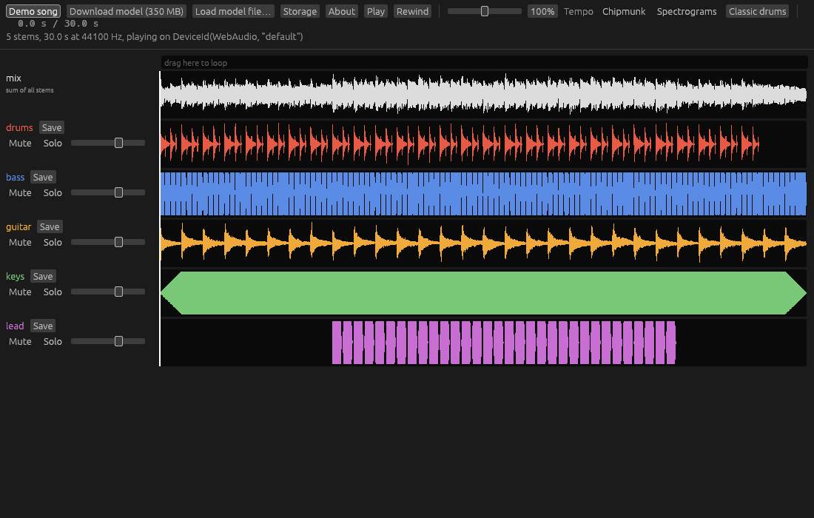

# Stemyla

Stemyla splits a song into its instruments, in the browser, on your own GPU.  Drop an MP3, WAV, FLAC, M4A or AIFF, press "Separate 6 stems", and get bass, drums, other, vocals, guitar and piano as separate lanes you can mute, solo, slow down (without changing pitch), loop, and save as WAV, FLAC, M4A or MP3.  An M4A is Apple Lossless, or AAC where the browser can encode it at 256 kbit/s.  Nothing leaves the computer.

It is written in Rust and compiled to WebAssembly, including the GPU code: the separation model runs on WebGPU through hand-written WGSL kernels.  It started as a winter-holiday project for learning to build software with AI, and to hear the guitar part of a song on its own.



## Using it

Open the published page (for example `https://beachape.com/stemyla/`) in a browser with WebGPU: Chrome or Edge on macOS, Windows or ChromeOS, Safari 26, or Firefox 141 and later on Windows ([status by platform](https://github.com/gpuweb/gpuweb/wiki/Implementation-Status)).  It has been tested in Chrome and Safari on Intel and Apple silicon Macs; other browsers should work but are untested.

1. Press **Download model (350 MB)** once.  The page keeps the model in the browser's own storage.
2. Press **Open song…** and choose an MP3, WAV, FLAC, M4A or AIFF song, drop one on the page, or press **Demo song**.  The page converts a song at a common rate from 8 kHz to 384 kHz, such as 48 kHz, to 44.1 kHz.  On a phone or tablet, **Open song…** is the way in.
3. Press **Separate 6 stems**.  On a laptop GPU a 3.5-minute song takes about 7 minutes.
4. Use **Mute** and **Solo** per lane, the tempo slider, and drag across the bar above the lanes to loop a section.  **Save** on a lane downloads it as WAV, FLAC, M4A (Apple Lossless) or MP3.  Where the browser can encode AAC at 256 kbit/s, as Chrome and Safari on a Mac can, the menu also offers M4A (AAC 256 kbps).  Chrome on Windows probably cannot, so its menu has no AAC item.  **Save** on the mix lane downloads the mix that you hear: the stems that Mute and Solo let through, at their volumes, at 100% tempo.  For a backing track, mute the vocals, then save the mix.

Each song you open, and its stems once separated, stays in the browser's storage, so a reload brings it back.  When browser storage is full or refuses a file, the page works in memory instead.  It also does so when the separation worker cannot read the song from storage.  In memory, the page opens and separates a song of up to 100 seconds.  The limit is less for a song of several files, or with stems in memory.  It saves a song of up to 100 seconds, and does not keep the stems.  The **Storage** menu lists the songs kept, opens or forgets one, shows the space used, and can remove the model.  **Reset…** (also offered when the separation worker stops) fetches the app's files again, bypassing the browser cache, or also deletes everything the page keeps, then reloads: use it when a reload does not help.  **About** links to the model, its code and its paper, and shows the build's version.

The native app (`cargo run -p app --release`) plays songs and stems but cannot separate; separation is web only.

### Page options

Add these to the page's address to diagnose the GPU:

* `?selftest`: checks the GPU against reference results (see "Checks" for the reference files).
* `?bench`: times the GPU kernels; `?bench=i64` times only those listed.
* `?profile=1`: logs GPU time per kernel after the self-test or a separation.
* `?mm=i64`, `?attn=split` (or `fused`, `time`, `freq`, `vfused`): override this GPU's measured kernel choice.
* `?weights=f32` (or `f16`, `auto`): how the GPU holds the weight matrices.  `auto`, the default, gives f16 at half the memory where the GPU passes the f16 start-up check, else f32.
* `?gpu=integrated`: asks for the low-power GPU.
* `?streamtest`: adds a "Run storage test" button, which measures playback from browser storage (`app/src/streamtest.rs`).

## The model

The separation model is BS-RoFormer SW, a six-stem [BS-RoFormer](https://arxiv.org/abs/2309.02612) whose architecture is open source (MIT, [lucidrains/BS-RoFormer](https://github.com/lucidrains/BS-RoFormer)).  The trained weights are a different matter: their trainer is unknown and no licence was ever stated for them (see [this open question](https://github.com/openmirlab/bs-roformer-infer/issues/3)).  So this repository and the published page do not contain them.  "Download model" fetches a copy that already exists on Hugging Face ([lumabeat/bs-roformer-sw](https://huggingface.co/lumabeat/bs-roformer-sw)) and checks its SHA-256 before use; "Load model file…" accepts a local `.safetensors` file instead.  Whether you may use the weights is for you to judge.

A PyTorch checkpoint (`BS-Rofo-SW-Fixed.ckpt`) converts to the file the app reads with:

```bash
cargo run -p xtask --release -- roformer-convert BS-Rofo-SW-Fixed.ckpt bs_roformer_sw.f16.safetensors
```

## Setting up a machine

Everything is built and served with Rust tools.  What each task needs, beyond a clone:

| To | You need |
| - | - |
| Anything | A C compiler, since some dependencies build C code (zstd in xtask, ring in Trunk): Xcode Command Line Tools on macOS (`xcode-select --install`), `build-essential` on Debian or Ubuntu. |
| Build and serve the web app | Rust stable, 1.99 or newer (CI pins 1.99.0), with the `wasm32-unknown-unknown` target, and [Trunk](https://trunkrs.dev/).  `cargo run -p xtask -- setup` installs both at the pins of `xtask/src/setup.rs`.  On its first build Trunk downloads `wasm-bindgen` and `wasm-opt` into its own cache, so that build needs the network. |
| Separate songs in it | A browser with WebGPU (see "Using it") and the model: **Download model** in the page, or a local `.safetensors` file (see "The model"). |
| Build the native app, `cargo test`, `cargo clippy` | git 2.42 or newer.  The `wasm32-unknown-unknown` target (`cargo run -p xtask -- setup wasm32`).  `jq` and the `rustfmt` component (`rustup component add rustfmt`), for the tests of the agent hooks; macOS 26 has `/usr/bin/jq`.  `ps`, `lsof` and `sleep`, for the tests of `xtask clean`.  On Debian or Ubuntu, `pkg-config libasound2-dev` (the audio output links ALSA) and `jq`. |
| The UI snapshot tests (`app/tests/ui.rs`) | A GPU, or a software Vulkan driver (`mesa-vulkan-drivers libvulkan1` on Debian or Ubuntu, with `WGPU_BACKEND=vulkan`).  The snapshot PNGs match lavapipe, which CI uses, and Metal on an Intel Mac with an AMD Radeon Pro 5500M.  Other GPUs may differ; with lavapipe installed, egui_kittest picks it.  To change a snapshot, see "Change the UI" in `docs/working-with-agents.md`. |
| The GPU kernel tests (`roformer-gpu`) | A Vulkan, Metal or DX12 GPU, or SwiftShader (see "Checks").  Kernel changes are judged on a real GPU, never SwiftShader alone. |
| The browser tests | `wasm-bindgen-cli` at the `wasm-bindgen` version in `Cargo.lock` (`xtask setup` installs it), and a browser's WebDriver (see "Browser tests").  CI runs them anyway; locally they are optional. |
| `?bench`, and the `bench` scenario | A browser with WebGPU; no model. |
| `?streamtest` | A browser with OPFS; no model.  With the defaults it writes about 2.9 GB of scratch files, and removes them at the end. |
| `?selftest`, and the `selftest`, `separate`, `worker-check`, `memory-budget`, `stored-stems`, `weights` and `perf` scenarios | A GPU, the model file, and for `selftest` the reference files made from it (see "Checks"). |
| The comparisons with PyTorch (`roformer`, `roformer-gpu`, `worker-check --reference`) | Fixtures from `tools/roformer_export.py`: Python 3 with `torch`, `numpy`, `pyyaml`, `ml_collections`, `safetensors` and [bs-roformer-infer](https://github.com/openmirlab/bs-roformer-infer) (module `bs_roformer`), plus the PyTorch checkpoint.  Without them those tests skip.  This is the only Python in the project, and it never builds or serves the app. |
| MP3 files from `xtask gen-song` | `ffmpeg` on `PATH` (optional; WAV files are always written). |
| `xtask publish` | Push access to the repository's `gh-pages` branch (see "Publishing"). |
| `xtask review mutants` | cargo-mutants, at its pin: `cargo run -p xtask -- setup cargo-mutants`. |
| `xtask clean` | `ps`, `lsof`, and `gh` signed in.  Without one, `xtask clean` keeps each item that needs it. |

From a fresh clone, the web app:

```bash
cargo run -p xtask -- setup                                    # each dev tool at its pin; --check only reports
(cd app && trunk build --release)                              # into app/dist
cargo run -p xtask --release -- serve app/dist --port 8080     # http://localhost:8080/
```

Model files, test fixtures, audio and stems stay outside git (ASSET-1): the weights have no stated licence and songs are copyrighted.  `.gitignore` keeps them out, and `no_audio_or_weights_are_tracked` checks the git index.  Keep a local model file in `third_party/models/`, and the PyTorch fixtures in `third_party/roformer/`.

## Checks

Before a push, run the local checks of CI:

```bash
cargo run -p xtask -- check --tier push
```

It runs the fmt, clippy, test, `docs-check` and Trunk build lines of the Commands in `CLAUDE.md`, which lists each command.  It also runs the GPU test line, which needs a GPU, when a path changes GPU code or is a workspace file.  It also runs that line when no path changed or no path is known (TD-70).  When `STEMYLA_PERF_WEIGHTS` names the model, it runs the perf gate (`e2e perf --gate`) in Chrome and Safari.  It runs no other browser test; CI runs those.  On Linux without a GPU, run the tests as CI does: `WGPU_BACKEND=vulkan cargo test --workspace --exclude roformer-gpu`.  That uses software Vulkan for the UI tests, and leaves out the GPU kernel tests, which are never judged on software alone.

The GPU kernel tests run on any Vulkan, Metal or DX12 GPU.  Without one, SwiftShader's Vulkan driver works: `STEMYLA_REQUIRE=gpu VK_ICD_FILENAMES=<path>/vk_swiftshader_icd.json WGPU_BACKEND=vulkan cargo test -p roformer-gpu --release`.  `STEMYLA_REQUIRE=gpu` makes a wrong driver path fail instead of skipping.  A pass on SwiftShader is not GPU evidence (GPU-3).

To use `?selftest`, make the reference files once and serve them too:

```bash
cargo run -p xtask --release -- roformer-selftest bs_roformer_sw.f16.safetensors third_party/roformer/selftest
cargo run -p xtask --release -- serve app/dist --port 8080 --mount /selftest=third_party/roformer/selftest
```

### Browser tests

The browser-only behaviour is tested in a real browser.  CI runs these tests in headless Chrome on Linux, and in Safari on macOS, where it also runs the real AAC encode in Chrome (TD-92).  Locally they are optional.  They need the test runner at the `wasm-bindgen` version in `Cargo.lock`.  `xtask web-test` stops when the two differ, for example after a `wasm-bindgen` update:

```bash
cargo run -p xtask -- setup wasm-bindgen-cli
```

They also need a browser's WebDriver.  On macOS, use Safari's: turn it on once with `safaridriver --enable` and Develop > "Allow Remote Automation" in Safari.  Otherwise, or with `--browser chrome`, use a ChromeDriver of Chrome's major version ([Chrome for Testing](https://googlechromelabs.github.io/chrome-for-testing/)) in `CHROMEDRIVER` or on `PATH`.  safaridriver starts no session while the screen is locked (`docs/references/local-browser-testing.md`).

```bash
cargo run -p xtask -- web-test                  # browser storage, audio output, the workers, the resampler (wasm-bindgen-test)
(cd app && trunk build --release)
cargo run -p xtask -- e2e smoke                 # the built page over WebDriver
cargo run -p xtask -- e2e selftest --weights bs_roformer_sw.f16.safetensors
```

The scenarios `smoke`, `decode`, `playback`, `old-session`, `audio-resume`, `storage`, `flac` and `save` need no model, and CI runs them.  `bench` needs WebGPU only.  `selftest`, `separate`, `worker-check`, `memory-budget`, `stored-stems`, `weights` and `perf` need a GPU and the model (`--weights`).  The module docs of `xtask/src/e2e.rs` give what each scenario checks and its options.  `scenario_limit_secs` there gives its time limit.  Those of `xtask/src/web_test.rs` do the same for `web-test`.

Logs and screenshots go to `target/e2e/<scenario>`.  `cargo run -p xtask -- clean` lists what runs leave, and `clean --yes` removes what it can prove safe.  `--swiftshader` runs WebGPU in software on a machine without a GPU: it is slow, and a compile check, not a verdict on the kernels.

## Publishing on GitHub Pages

The page is static, so a `gh-pages` branch serves it.  One command builds it for the site's path, commits the build to `gh-pages` and pushes that branch:

```bash
cargo run -p xtask --release -- publish        # for https://<user>.github.io/stemyla/ or <custom domain>/stemyla/
```

It refuses to run with uncommitted changes, so every published version names the commit it was built from.  It commits through a temporary git index, so your checkout is never switched or touched.  Options:

* `--public-url /other-path/`: build for a different path.
* `--no-push`: commit locally only.
* `--remote <name>`, `--branch <name>`: where to publish.  `publish` reads the remote before it builds; to publish locally with no network, pass `--remote . --no-push`.
* `--allow-dirty`: publish uncommitted changes, with a build id that says so.
* `--skip-if-behind <branch>`: publish only the tip of that branch, or a commit of it newer than each published build of that branch.

Its steps are in the module docs of `xtask/src/publish.rs`.

Each build goes in its own folder, `v/<id>/`, named after its commit, and is never changed.  The About menu shows the id, linked to its commit on GitHub.  The link gives a 404 until that commit is pushed, because `publish` pushes only `gh-pages`.  A build that `publish` did not make shows "unpublished build".  Only the root `index.html` changes: it is a copy of the newest build's page, whose `<base href>` points into that build's folder.  So a browser that keeps old JavaScript in its cache never pairs it with a newer build's wasm.  The branch keeps the newest 3 builds.  `publish` needs the full history of `gh-pages`, so never squash or rewrite that branch (GIT-3).

On a push to `main`, CI publishes the pushed commit after every other CI job passes, the Safari tests included.  It passes `--skip-if-behind main`, so a re-run of an old run cannot roll the site back.

The first time, choose the `gh-pages` branch under the repository's Settings → Pages.  A project site on an account whose user site has a custom domain (`beachape.com` here) appears under that domain at `/stemyla/`.  The site is about 18 MB with 3 builds of about 6 MB each; the model is not part of it.

The CDN in front of `beachape.com` (Cloudflare) lets browsers keep `.js` files for a month.  That is safe for the `v/` folders, but the root `index.html` must stay short-lived: a "Cache Everything" rule, or a long cache lifetime on HTML, would keep browsers on an old build, and once that build is pruned its files return 404.

## Layout

| Path | What |
| - | - |
| `app/` | the egui app (web and native); `index.html` is Trunk's entry point |
| `worker/` | the Web Worker that runs separations |
| `decoder/` | the Web Worker that decodes a stored song in blocks into browser storage, and makes the overviews of its stems and its classic drums (`decode-worker`) |
| `writer/` | the Web Worker that writes the page's song-sized files into browser storage (`write-worker`) |
| `roformer-gpu/` | the network on WebGPU: WGSL kernels and their driver |
| `roformer/` | STFT, chunking, weights, and the CPU reference network |
| `engine/` | decoding, playback, time-stretch, classic drum separation |
| `dsp/` | small audio functions in plain Rust |
| `synth/` | the demo song |
| `m4a/` | the bytes of an M4A file: Apple Lossless (ALAC) from a safe port of an ALAC encoder, or AAC |
| `protocol/` | the messages between the page and its three workers (`stem-protocol`) |
| `test-support/` | `skip` and `STEMYLA_REQUIRE`, which make a test that cannot run fail where evidence is claimed |
| `xtask/` | the static server, the browser test runners and other tools |
| `docs/ARCHITECTURE.md` | how the pieces fit together |
| `docs/working-with-agents.md` | how to get work done here with an AI coding agent |

## Licence

MIT or Apache-2.0, at your option (`LICENSE-MIT`, `LICENSE-APACHE`), except `m4a/`.  `m4a/` is Apache-2.0 only (`LICENSE-APACHE`), because its ALAC encoder is a port of Apple's ALAC reference, which is Apache-2.0 only (decision 0029).  The web app ships `m4a/` in its stem worker, so the web app holds Apache-2.0-only code.  Third-party crates and their licences are listed in `THIRD-PARTY.md`.  The model weights are not covered; see "The model".
