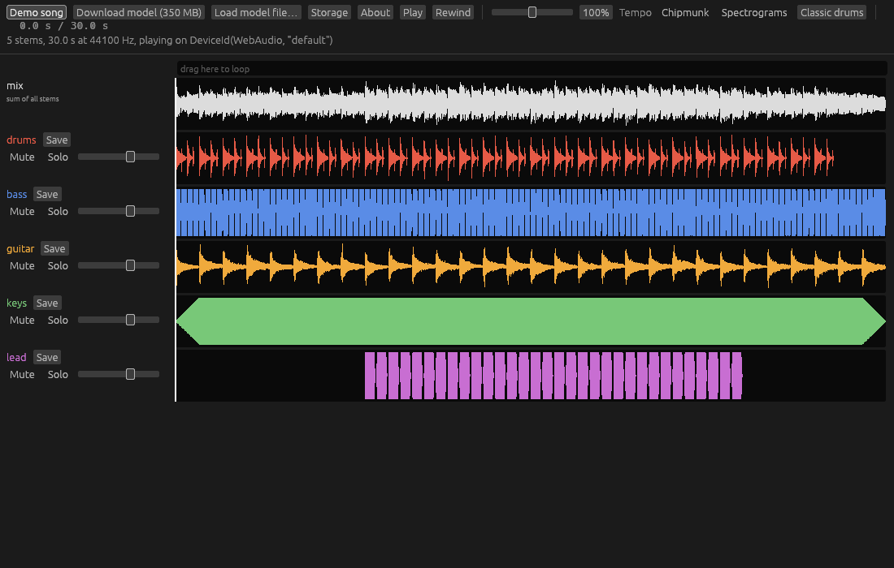

# Stemyla

Stemyla splits a song into its instruments, in the browser, on your own GPU.  Drop an MP3 or WAV, press "Separate 6 stems", and get bass, drums, other, vocals, guitar and piano as separate lanes you can mute, solo, slow down (without changing pitch), loop, and save as WAV or MP3.  Nothing leaves the computer.

It is written in Rust and compiled to WebAssembly, including the GPU code: the separation model runs on WebGPU through hand-written WGSL kernels.  It started as a winter-holiday project for learning to build software with AI, and to hear the guitar part of a song on its own.



## Using it

Open the published page (for example `https://beachape.com/stemyla/`) in a browser with WebGPU: Chrome or Edge on macOS, Windows or ChromeOS, Safari 26, or Firefox 141 and later on Windows ([status by platform](https://github.com/gpuweb/gpuweb/wiki/Implementation-Status)).  It has been tested in Chrome on macOS (a Radeon Pro 5500M and an Intel UHD 630); other browsers should work but are untested.

1. Press **Download model (350 MB)** once.  The page keeps the model in the browser's own storage.
2. Press **Open song…** and choose a song (44.1 kHz MP3 or WAV), drop one on the page, or press **Demo song**.  On a phone or tablet, **Open song…** is the way in.
3. Press **Separate 6 stems**.  On a laptop GPU a 3.5-minute song takes about 7 minutes.
4. Use **Mute** and **Solo** per lane, the tempo slider, and drag across the bar above the lanes to loop a section.  **Save** on a lane downloads it as WAV or MP3.

Each song you open, and its stems once separated, stays in the browser, so a reload brings it back.  The **Storage** menu lists the songs kept, opens or forgets one, shows the space used, and can remove the model.  **Reset…** (also offered when the separation worker stops) fetches the app's files again, bypassing the browser cache, or also deletes everything the page keeps, then reloads: use it when a reload does not help.  **About** links to the model, its code and its paper, and shows the build's version.

Page options, added to the address: `?selftest` checks the GPU against reference results (when served with the reference files, see below); `?bench` times the GPU kernels (`?bench=i64` only those listed); `?profile=1` logs GPU time per kernel after the self-test or a separation; `?mm=i64` and `?attn=split` (or `fused`, `time`, `freq`) override this GPU's measured kernel choice; `?gpu=integrated` asks for the low-power GPU.

## The model

The separation model is BS-RoFormer SW, a six-stem [BS-RoFormer](https://arxiv.org/abs/2309.02612) whose architecture is open source (MIT, [lucidrains/BS-RoFormer](https://github.com/lucidrains/BS-RoFormer)).  The trained weights are a different matter: their trainer is unknown and no licence was ever stated for them (see [this open question](https://github.com/openmirlab/bs-roformer-infer/issues/3)).  So this repository and the published page do not contain them.  "Download model" fetches a copy that already exists on Hugging Face ([lumabeat/bs-roformer-sw](https://huggingface.co/lumabeat/bs-roformer-sw)) and checks its SHA-256 before use; "Load model file…" accepts a local `.safetensors` file instead.  Whether you may use the weights is for you to judge.

A PyTorch checkpoint (`BS-Rofo-SW-Fixed.ckpt`) converts to the file the app reads with:

```bash
cargo run -p xtask --release -- roformer-convert BS-Rofo-SW-Fixed.ckpt bs_roformer_sw.f16.safetensors
```

## Setting up a machine

Everything is built and served with Rust tools.  What each task needs, beyond a clone:

| To | You need |
| - | - |
| Anything | A C compiler, since some dependencies build C code (zstd in xtask, ring in Trunk): Xcode Command Line Tools on macOS (`xcode-select --install`), `build-essential` on Debian or Ubuntu. |
| Build and serve the web app | Rust stable, 1.99 or newer (CI pins 1.99.0), with the `wasm32-unknown-unknown` target; [Trunk](https://trunkrs.dev/) 0.21.14, the version CI uses.  On its first build Trunk downloads `wasm-bindgen` and `wasm-opt` into its own cache, so that build needs the network. |
| Separate songs in it | A browser with WebGPU (see "Using it") and the model: **Download model** in the page, or a local `.safetensors` file (see "The model"). |
| Build the native app, `cargo test`, `cargo clippy` | git 2.42 or newer, for the checks of the git index (`xtask/tests/rules.rs`).  The `wasm32` clippy command also needs `rustup target add wasm32-unknown-unknown`.  On Debian or Ubuntu, `pkg-config libasound2-dev` (the audio output links ALSA).  `jq` and the `rustfmt` component (`rustup component add rustfmt`), for `the_rustfmt_hook_formats_rust_files`; macOS 26 has `/usr/bin/jq`, and on Debian or Ubuntu run `apt install jq`. |
| The UI snapshot tests (`app/tests/ui.rs`) | A GPU, or a software Vulkan driver (`mesa-vulkan-drivers libvulkan1` on Debian or Ubuntu, with `WGPU_BACKEND=vulkan`).  The snapshot PNGs match lavapipe, and Metal on an Intel Mac (AMD Radeon Pro 5500M), at egui_kittest's default threshold.  Other GPUs may differ; with lavapipe installed, egui_kittest picks it.  To change a snapshot on purpose, run `UPDATE_SNAPSHOTS=1 cargo test -p app --test ui`.  Look at each changed `<name>.png`; the old image is in `<name>.old.png`.  Commit only the PNGs of the views that you changed.  Restore the others with `git checkout`.  Name each changed PNG in the PR.  If a snapshot fails on your machine and you did not change the UI, do not update it.  Ask the maintainer; CI compares the snapshots on lavapipe. |
| The GPU kernel tests (`roformer-gpu`) | A Vulkan, Metal or DX12 GPU, or SwiftShader (see "Checks").  Kernel changes are judged on a real GPU, never SwiftShader alone. |
| The browser tests | `wasm-bindgen-cli` at the `wasm-bindgen` version in `Cargo.lock`, and a browser's WebDriver (see "Browser tests").  CI runs them anyway; locally they are optional. |
| `?bench`, and the `bench` scenario | A browser with WebGPU; no model. |
| `?selftest`, and the `selftest`, `separate` and `worker-check` scenarios | A GPU, the model file, and for `selftest` the reference files made from it (below). |
| The comparisons with PyTorch (`roformer`, `roformer-gpu`, `worker-check --reference`) | Fixtures from `tools/roformer_export.py`: Python 3 with `torch`, `numpy`, `pyyaml`, `ml_collections`, `safetensors` and [bs-roformer-infer](https://github.com/openmirlab/bs-roformer-infer) (module `bs_roformer`), plus the PyTorch checkpoint.  Without them those tests skip, and `STEMYLA_REQUIRE=fixtures` makes the `roformer` and `roformer-gpu` tests fail.  This is the only Python in the project, and it never builds or serves the app. |
| MP3 files from `xtask gen-song` | `ffmpeg` on `PATH` (optional; WAV files are always written). |
| `xtask publish` | Push access to the repository's `gh-pages` branch (see "Publishing"). |
| `xtask review mutants` | cargo-mutants 27.1.0: `cargo install --locked cargo-mutants@27.1.0`.  A run copies the tree and builds the copy cold: for the `xtask` tests, about 140 s and 1.4 GB. |

From a fresh clone, the web app:

```bash
rustup target add wasm32-unknown-unknown
cargo install --locked trunk --version 0.21.14                 # --locked matters: without it the build of Trunk itself fails
(cd app && trunk build --release)                              # into app/dist
cargo run -p xtask --release -- serve app/dist --port 8080     # http://localhost:8080/
```

Then the checks CI gates on:

```bash
cargo fmt --all --check
cargo clippy --workspace --all-targets -- -D warnings
cargo clippy -p synth --all-targets -- -D warnings
cargo clippy -p app -- -D warnings
cargo clippy -p app --all-targets -- -D warnings
cargo clippy --target wasm32-unknown-unknown -p app -p stem-worker -p stem-protocol -p engine --all-targets -- -D warnings
cargo test --workspace
```

On Linux without a GPU, run the tests as CI does: `WGPU_BACKEND=vulkan cargo test --workspace --exclude roformer-gpu` (software Vulkan for the UI tests, and no GPU kernel tests, which are never judged on software alone).  CI also runs `cargo test -p roformer-gpu --lib` and `cargo test -p roformer-gpu --doc`, which need no GPU.  A snapshot can fail on CI and pass on your machine, on any PR.  Then do not change the threshold, `max_failed_pixels` or any `kittest.toml`.  Download the `ui-snapshots` artifact.  Read the failed pixels at each threshold in the log.  A failure at the default means that a pixel changed by more than 1 colour level.  A Mesa or runner update can cause it, or new content in the UI that renders differently on lavapipe.  Stop and ask the maintainer, who chooses what to change (TD-29 in `docs/tech-debt.md`).  For a UI change, the `.new.png` in the artifact is lavapipe's image.  Do not commit it without the maintainer's approval.

Model files, test fixtures, audio and stems live outside git (`.gitignore` keeps `third_party/`, `*.safetensors`, `*.wav`, `*.mp3` and other audio and weight files out, and `no_audio_or_weights_are_tracked` checks the git index): the weights have no stated licence and songs are copyrighted.  The tests that compare with PyTorch read their fixtures from `third_party/roformer/`.

To use `?selftest`, make the reference files once and serve them too:

```bash
cargo run -p xtask --release -- roformer-selftest bs_roformer_sw.f16.safetensors third_party/roformer/selftest
cargo run -p xtask --release -- serve app/dist --port 8080 --mount /selftest=third_party/roformer/selftest
```

The native app (`cargo run -p app --release`) plays songs and stems but cannot separate; separation is web only.

## Publishing on GitHub Pages

The page is static, so a `gh-pages` branch serves it.  One command builds it for the site's path, commits the build to `gh-pages` and pushes that branch:

```bash
cargo run -p xtask --release -- publish        # for https://<user>.github.io/stemyla/ or <custom domain>/stemyla/
```

It refuses to run with uncommitted changes, so every published version names the commit it was built from.  It commits through a temporary git index, so the checkout you work in is never switched or touched, and it builds on the remote's `gh-pages` if another clone published last.  Options: `--public-url /other-path/` for a different path, `--no-push` to commit locally only, `--remote <name>`, `--branch <name>`, `--allow-dirty`, `--skip-if-behind <branch>`.  It contacts the remote before building; to publish locally with no network, pass `--remote . --no-push`.

Each build goes in its own folder, `v/<id>/`, named after its commit (`<12-character hash>`, or `<hash>-dirty-<unix seconds>` with `--allow-dirty`), and a published folder is never changed.  The About menu shows the id, linked to its commit on GitHub (a 404 until that commit is pushed; `publish` pushes only `gh-pages`); other builds show "unpublished build".  Only the root `index.html` changes in place: it is a copy of the newest build's page, whose `<base href>` points into that build's folder.  So a browser that keeps old JavaScript in its cache can never pair it with a newer build's wasm.  The branch keeps the newest 3 builds, listed newest first in `v/VERSIONS`, because a browser may still hold the previous root page for its 10-minute cache lifetime.  Publishing a build id again keeps its published copy, even if it has been pruned since, so `gh-pages` needs its full history: never squash or rewrite it, and publish from a full clone (CI checks out with `fetch-depth: 0`).  CI passes `--skip-if-behind main`, which publishes the run's commit only if it is the tip of `main`, or a commit of `main` newer than every published build of `main` (a preview published by hand from another branch does not count).  Re-running an old run therefore cannot roll the site back, and a commit is still published when the next one never is (its run failed, or it skipped CI).

The first time, choose the `gh-pages` branch under the repository's Settings → Pages.  A project site on an account whose user site has a custom domain (`beachape.com` here) appears under that domain at `/stemyla/`.  The site is about 18 MB with 3 builds of about 6 MB each; the model is not part of it.

The CDN in front of `beachape.com` (Cloudflare) lets browsers keep `.js` files for a month.  That is safe for the `v/` folders, but the root `index.html` must stay short-lived: a "Cache Everything" rule, or a long cache lifetime on HTML, would keep browsers on an old build, and once that build is pruned its files return 404.

## Checks

```bash
cargo test --workspace                       # unit, integration and UI snapshot tests (Linux needs ALSA headers)
cargo clippy --workspace --all-targets
cargo clippy -p synth --all-targets          # synth without its files feature
cargo clippy -p app                          # app's lib and binary without any files feature
cargo clippy -p app --all-targets            # app's tests without the workspace's merged features
cargo clippy --target wasm32-unknown-unknown -p app -p stem-worker -p stem-protocol -p engine --all-targets  # the web code, which compiles only for wasm32
```

* `roformer` and `roformer-gpu` compare the network with PyTorch when the fixtures exist (`tools/roformer_export.py`, a Python script that only generates test data; tests skip without them, and `STEMYLA_REQUIRE=fixtures` makes them fail).
* The GPU kernel tests run on any Vulkan, Metal or DX12 GPU.  Without one, SwiftShader's Vulkan driver works: `STEMYLA_REQUIRE=gpu VK_ICD_FILENAMES=<path>/vk_swiftshader_icd.json WGPU_BACKEND=vulkan cargo test -p roformer-gpu --release`.  `STEMYLA_REQUIRE=gpu` makes a wrong driver path fail instead of skipping.  A pass on SwiftShader is not GPU evidence (GPU-3).

### Browser tests

The browser-only behaviour is tested in a real browser.  CI runs these in headless Chrome; locally they are optional and need one install, the test runner at the `wasm-bindgen` version in `Cargo.lock` (`xtask web-test` prints the exact line when the two differ, for example after a `wasm-bindgen` update):

```bash
cargo install wasm-bindgen-cli --version 0.2.129 --locked
```

and a browser's WebDriver: on macOS, Safari's, turned on once with `safaridriver --enable` and Develop > "Allow Remote Automation" in Safari; otherwise, or with `--browser chrome`, a ChromeDriver matching Chrome's major version ([Chrome for Testing](https://googlechromelabs.github.io/chrome-for-testing/)) in `CHROMEDRIVER` or on `PATH`.  Safari 27.0's safaridriver may fail with "timed out while connecting to a Safari instance"; use `--browser chrome` meanwhile.

```bash
cargo run -p xtask -- web-test                  # browser storage, audio output, the worker (wasm-bindgen-test)
(cd app && trunk build --release)
cargo run -p xtask -- e2e smoke                 # the built page over WebDriver; also audio-resume, storage
cargo run -p xtask -- e2e selftest --weights bs_roformer_sw.f16.safetensors
```

* `smoke`, `audio-resume` and `storage` need no model.  `bench` needs WebGPU.  `selftest`, `separate` and `worker-check` need the model (`--weights`); `selftest` also the reference files above, and `worker-check` compares with PyTorch only given `--reference` (the outputs of `tools/roformer_export.py`).
* Logs and screenshots go to `target/e2e/<scenario>`.  `--swiftshader` runs WebGPU in software on a machine without a GPU (slow; a compile check, not a verdict on the kernels).

## Layout

| Path | What |
| - | - |
| `app/` | the egui app (web and native); `index.html` is Trunk's entry point |
| `worker/` | the Web Worker that runs separations |
| `roformer-gpu/` | the network on WebGPU: WGSL kernels and their driver |
| `roformer/` | STFT, chunking, weights, and the CPU reference network |
| `engine/` | decoding, playback, time-stretch, classic drum separation |
| `dsp/` | small audio functions in plain Rust |
| `synth/` | the demo song |
| `protocol/` | the messages between the page and the worker (`stem-protocol`) |
| `test-support/` | `skip` and `STEMYLA_REQUIRE`, which make a test that cannot run fail where evidence is claimed |
| `xtask/` | the static server, the browser test runners and other tools |
| `docs/ARCHITECTURE.md` | how the pieces fit together |
| `docs/working-with-agents.md` | how to get work done here with an AI coding agent |

## Licence

MIT or Apache-2.0, at your option (`LICENSE-MIT`, `LICENSE-APACHE`).  Third-party crates and their licences are listed in `THIRD-PARTY.md`.  The model weights are not covered; see "The model".
