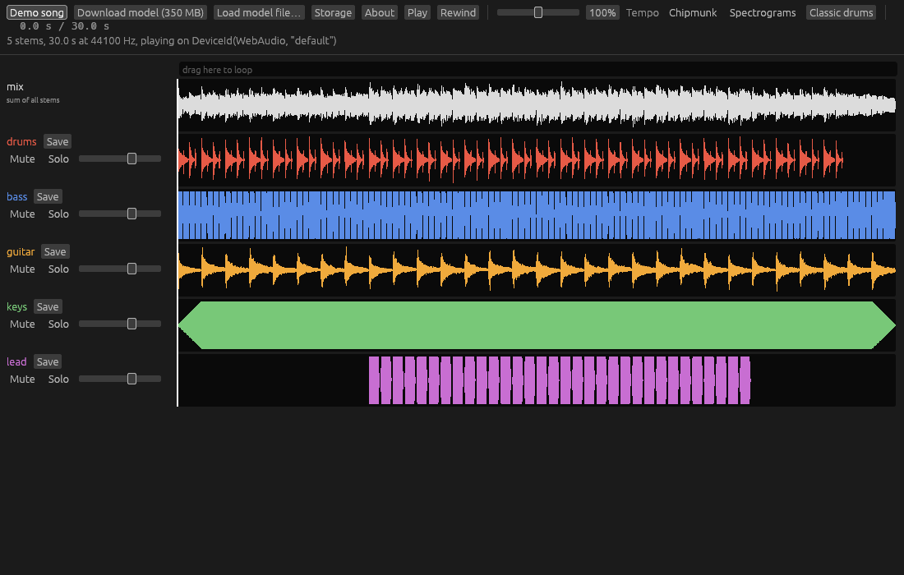

# Stemyla

Stemyla splits a song into its instruments, in the browser, on your own GPU.  Drop an MP3, WAV, FLAC, M4A or AIFF, press "Separate 6 stems", and get bass, drums, other, vocals, guitar and piano as separate lanes you can mute, solo, slow down (without changing pitch), loop, and save as WAV, FLAC, M4A or MP3.  An M4A is Apple Lossless, or AAC where the browser can encode it at 256 kbit/s.  Nothing leaves the computer.

It is written in Rust and compiled to WebAssembly, including the GPU code: the separation model runs on WebGPU through hand-written WGSL kernels.  It started as a winter-holiday project for learning to build software with AI, and to hear the guitar part of a song on its own.



## Using it

Open the published page (for example `https://beachape.com/stemyla/`) in a browser with WebGPU: Chrome or Edge on macOS, Windows or ChromeOS, Safari 26, or Firefox 141 and later on Windows ([status by platform](https://github.com/gpuweb/gpuweb/wiki/Implementation-Status)).  It has been tested in Chrome on macOS (a Radeon Pro 5500M and an Intel UHD 630); other browsers should work but are untested.

1. Press **Download model (350 MB)** once.  The page keeps the model in the browser's own storage.
2. Press **Open song…** and choose an MP3, WAV, FLAC, M4A or AIFF song, drop one on the page, or press **Demo song**.  The page converts a song at a common rate from 8 kHz to 384 kHz, such as 48 kHz, to 44.1 kHz.  On a phone or tablet, **Open song…** is the way in.
3. Press **Separate 6 stems**.  On a laptop GPU a 3.5-minute song takes about 7 minutes.
4. Use **Mute** and **Solo** per lane, the tempo slider, and drag across the bar above the lanes to loop a section.  **Save** on a lane downloads it as WAV, FLAC, M4A (Apple Lossless) or MP3.  Where the browser can encode AAC at 256 kbit/s, as Chrome and Safari on a Mac can, the menu also offers M4A (AAC 256 kbps).  Chrome on Windows probably cannot, so its menu has no AAC item (TD-94).  **Save** on the mix lane downloads the mix that you hear: the stems that Mute and Solo let through, at their volumes, at 100% tempo.  For a backing track, mute the vocals, then save the mix.  A save writes its file to browser storage first, and the browser downloads it from there.  When browser storage cannot hold the file, a song of up to 100 seconds saves in memory, and a longer song does not save.

Each song you open, and its stems once separated, stays in the browser, so a reload brings it back.  **Separate 6 stems** also keeps the song's mix in browser storage, for the worker to read.  The page separates a song in memory when browser storage has too little free space.  It does the same when storage refuses the mix or the stems, or when the worker cannot read the mix.  In memory, the page separates a song of up to 100 seconds, or less for a song of several files or with stems in memory.  It does not keep the stems.  It refuses a longer song.  When browser storage cannot keep a song, the page opens it in memory only within the same limit.  The **Storage** menu lists the songs kept, opens or forgets one, shows the space used, and can remove the model.  **Reset…** (also offered when the separation worker stops) fetches the app's files again, bypassing the browser cache, or also deletes everything the page keeps, then reloads: use it when a reload does not help.  **About** links to the model, its code and its paper, and shows the build's version.

Page options, added to the address: `?selftest` checks the GPU against reference results (when served with the reference files, see below); `?bench` times the GPU kernels (`?bench=i64` only those listed); `?profile=1` logs GPU time per kernel after the self-test or a separation; `?mm=i64` and `?attn=split` (or `fused`, `time`, `freq`) override this GPU's measured kernel choice; `?weights=f32` (or `f16`, `auto`) sets how the GPU holds the weight matrices: `auto`, or no setting, gives f16 at half the memory where the GPU passes the f16 start-up check, else f32; `?gpu=integrated` asks for the low-power GPU.  `?streamtest` adds a "Run storage test" button.  The test measures playback from browser storage and logs `streamtest:` lines.  `st_minutes`, `st_play` and `st_seeks` set its size (`app/src/streamtest.rs`).

## The model

The separation model is BS-RoFormer SW, a six-stem [BS-RoFormer](https://arxiv.org/abs/2309.02612) whose architecture is open source (MIT, [lucidrains/BS-RoFormer](https://github.com/lucidrains/BS-RoFormer)).  The trained weights are a different matter: their trainer is unknown and no licence was ever stated for them (see [this open question](https://github.com/openmirlab/bs-roformer-infer/issues/3)).  So this repository and the published page do not contain them.  "Download model" fetches a copy that already exists on Hugging Face ([lumabeat/bs-roformer-sw](https://huggingface.co/lumabeat/bs-roformer-sw)) and checks its SHA-256 before use; "Load model file…" accepts a local `.safetensors` file instead.  Whether you may use the weights is for you to judge.

A PyTorch checkpoint (`BS-Rofo-SW-Fixed.ckpt`) converts to the file the app reads with:

```bash
cargo run -p xtask --release -- roformer-convert BS-Rofo-SW-Fixed.ckpt bs_roformer_sw.f16.safetensors
```

## Setting up a machine

Everything is built and served with Rust tools.  What each task needs, beyond a clone:

| To | You need |
| - | - |
| Anything | A C compiler, since some dependencies build C code (zstd in xtask, ring in Trunk): Xcode Command Line Tools on macOS (`xcode-select --install`), `build-essential` on Debian or Ubuntu. |
| Build and serve the web app | Rust stable, 1.99 or newer (CI pins 1.99.0), with the `wasm32-unknown-unknown` target, and [Trunk](https://trunkrs.dev/).  `cargo run -p xtask -- setup` installs both at the pins of `xtask/src/setup.rs`.  On its first build Trunk downloads `wasm-bindgen` and `wasm-opt` into its own cache, so that build needs the network. |
| Separate songs in it | A browser with WebGPU (see "Using it") and the model: **Download model** in the page, or a local `.safetensors` file (see "The model"). |
| Build the native app, `cargo test`, `cargo clippy` | git 2.42 or newer, for the checks of the git index (`xtask/tests/rules.rs`).  The `wasm32` clippy command and `cargo test` also need the `wasm32-unknown-unknown` target.  `cargo test` needs it for `a_wasm_build_reads_the_build_value` (`test-support`).  Install it with `cargo run -p xtask -- setup wasm32`.  On Debian or Ubuntu, `pkg-config libasound2-dev` (the audio output links ALSA).  `jq`, for the hook tests `the_rustfmt_hook_formats_rust_files`, `the_bash_guard_refuses_writes` and `the_bash_guard_explains_each_refusal`.  macOS 26 has `/usr/bin/jq`, and on Debian or Ubuntu run `apt install jq`.  The `rustfmt` component (`rustup component add rustfmt`), for `the_rustfmt_hook_formats_rust_files`. |
| The UI snapshot tests (`app/tests/ui.rs`) | A GPU, or a software Vulkan driver (`mesa-vulkan-drivers libvulkan1` on Debian or Ubuntu, with `WGPU_BACKEND=vulkan`).  The snapshot PNGs match lavapipe, and Metal on an Intel Mac (AMD Radeon Pro 5500M), at egui_kittest's default threshold.  Other GPUs may differ; with lavapipe installed, egui_kittest picks it.  To change a snapshot on purpose, run `UPDATE_SNAPSHOTS=1 cargo test -p app --test ui`.  Look at each changed `<name>.png`; the old image is in `<name>.old.png`.  Commit only the PNGs of the views that you changed.  Restore the others with `git checkout`.  Name each changed PNG in the PR.  If a snapshot fails on your machine and you did not change the UI, do not update it.  Ask the maintainer; CI compares the snapshots on lavapipe. |
| The GPU kernel tests (`roformer-gpu`) | A Vulkan, Metal or DX12 GPU, or SwiftShader (see "Checks").  Kernel changes are judged on a real GPU, never SwiftShader alone. |
| The browser tests | `wasm-bindgen-cli` at the `wasm-bindgen` version in `Cargo.lock` (`xtask setup` installs it), and a browser's WebDriver (see "Browser tests").  CI runs them anyway; locally they are optional. |
| `?bench`, and the `bench` scenario | A browser with WebGPU; no model. |
| `?streamtest` | A browser with OPFS; no model.  With the defaults it writes about 2.9 GB of scratch files, and removes them at the end. |
| `?selftest`, and the `selftest`, `separate`, `worker-check`, `memory-budget`, `stored-stems`, `weights` and `perf` scenarios | A GPU, the model file, and for `selftest` the reference files made from it (below). |
| The comparisons with PyTorch (`roformer`, `roformer-gpu`, `worker-check --reference`) | Fixtures from `tools/roformer_export.py`: Python 3 with `torch`, `numpy`, `pyyaml`, `ml_collections`, `safetensors` and [bs-roformer-infer](https://github.com/openmirlab/bs-roformer-infer) (module `bs_roformer`), plus the PyTorch checkpoint.  Without them those tests skip, and `STEMYLA_REQUIRE=fixtures` makes the `roformer` and `roformer-gpu` tests fail.  This is the only Python in the project, and it never builds or serves the app. |
| MP3 files from `xtask gen-song` | `ffmpeg` on `PATH` (optional; WAV files are always written). |
| `xtask publish` | Push access to the repository's `gh-pages` branch (see "Publishing"). |
| `xtask review mutants` | cargo-mutants, at its pin: `cargo run -p xtask -- setup cargo-mutants`.  A run copies the tree and builds the copy cold: for the `xtask` tests, about 140 s and 1.4 GB. |
| `xtask clean` | `ps` and `lsof`, and `gh` signed in, to read the open and merged PRs.  Without one, `xtask clean` keeps each item that needs it.  Its tests use `ps`, `lsof`, `sleep` and a fake `gh`. |

From a fresh clone, the web app:

```bash
cargo run -p xtask -- setup                                    # each dev tool at its pin; --check only reports
(cd app && trunk build --release)                              # into app/dist
cargo run -p xtask --release -- serve app/dist --port 8080     # http://localhost:8080/
```

Then the checks CI gates on.  `cargo run -p xtask -- check --tier push` runs the matching lines of `CLAUDE.md`'s Commands (decision 0026).  Those lines split the `roformer-gpu` tests from the workspace tests.  They also add `docs-check` and the Trunk build.  They add the GPU test line when the paths change GPU code, or when no path changed or is known (TD-70).  So tier `push` does not run the block below as it stands:

```bash
cargo fmt --all --check
cargo clippy --workspace --all-targets -- -D warnings
cargo clippy -p synth --all-targets -- -D warnings
cargo clippy -p app -- -D warnings
cargo clippy -p app --all-targets -- -D warnings
cargo clippy --target wasm32-unknown-unknown -p app -p stem-worker -p decode-worker -p stem-protocol -p engine --all-targets -- -D warnings
cargo test --workspace
```

On Linux without a GPU, run the tests as CI does: `WGPU_BACKEND=vulkan cargo test --workspace --exclude roformer-gpu` (software Vulkan for the UI tests, and no GPU kernel tests, which are never judged on software alone).  CI also runs `cargo test -p roformer-gpu --lib` and `cargo test -p roformer-gpu --doc`, which need no GPU.  It runs `cargo test -p engine` alone too.  A workspace build gives `engine` the features of other members: the default feature of `app` turns on the `cpal` feature of `engine`.  It runs the doctests again on a pinned nightly, which checks the error code of each `compile_fail` doctest.  A snapshot can fail on CI and pass on your machine, on any PR.  Then do not change the threshold, `max_failed_pixels` or any `kittest.toml`.  Download the `ui-snapshots` artifact.  Read the failed pixels at each threshold in the log.  A failure at the default means that a pixel changed by more than 1 colour level.  A Mesa or runner update can cause it, or new content in the UI that renders differently on lavapipe.  Stop and ask the maintainer, who chooses what to change (TD-29 in `docs/tech-debt.md`).  For a UI change, the `.new.png` in the artifact is lavapipe's image.  Do not commit it without the maintainer's approval.

Model files, test fixtures, audio and stems live outside git (`.gitignore` keeps `third_party/`, `*.safetensors`, `*.wav`, `*.mp3` and other audio and weight files out, and `no_audio_or_weights_are_tracked` checks the git index): the weights have no stated licence and songs are copyrighted.  The tests that compare with PyTorch read their fixtures from `third_party/roformer/`.  Keep a local model file in `third_party/models/`.  Give its absolute path to `--weights` and `STEMYLA_PERF_WEIGHTS`, because a review worktree has no ignored files.

To use `?selftest`, make the reference files once and serve them too:

```bash
cargo run -p xtask --release -- roformer-selftest bs_roformer_sw.f16.safetensors third_party/roformer/selftest
cargo run -p xtask --release -- serve app/dist --port 8080 --mount /selftest=third_party/roformer/selftest
```

The native app (`cargo run -p app --release`) plays songs and stems but cannot separate; separation is web only.

## Publishing on GitHub Pages

The page is static, so a `gh-pages` branch serves it.  One command builds it for the site's path, commits the build to `gh-pages` and pushes that branch:

```bash
cargo run -p xtask --release -- publish        # for https://<user>.github.io/stemyla/ or <custom domain>/stemyla/
```

It refuses to run with uncommitted changes, so every published version names the commit it was built from.  It commits through a temporary git index, so the checkout you work in is never switched or touched, and it builds on the remote's `gh-pages` if another clone published last.  Options: `--public-url /other-path/` for a different path, `--no-push` to commit locally only, `--remote <name>`, `--branch <name>`, `--allow-dirty`, `--skip-if-behind <branch>`.  It contacts the remote before building; to publish locally with no network, pass `--remote . --no-push`.

Each build goes in its own folder, `v/<id>/`, named after its commit (`<12-character hash>`, or `<hash>-dirty-<unix seconds>` with `--allow-dirty`), and a published folder is never changed.  The About menu shows the id, linked to its commit on GitHub (a 404 until that commit is pushed; `publish` pushes only `gh-pages`); other builds show "unpublished build".  Only the root `index.html` changes in place: it is a copy of the newest build's page, whose `<base href>` points into that build's folder.  So a browser that keeps old JavaScript in its cache can never pair it with a newer build's wasm.  The branch keeps the newest 3 builds, listed newest first in `v/VERSIONS`, because a browser may still hold the previous root page for its 10-minute cache lifetime.  Publishing a build id again keeps its published copy, even if it has been pruned since, so `gh-pages` needs its full history: never squash or rewrite it, and publish from a full clone (CI checks out with `fetch-depth: 0`).  CI passes `--skip-if-behind main`, which publishes the run's commit only if it is the tip of `main`, or a commit of `main` newer than every published build of `main` (a preview published by hand from another branch does not count).  Re-running an old run therefore cannot roll the site back, and a commit is still published when the next one never is (its run failed, or it skipped CI).

The first time, choose the `gh-pages` branch under the repository's Settings → Pages.  A project site on an account whose user site has a custom domain (`beachape.com` here) appears under that domain at `/stemyla/`.  The site is about 18 MB with 3 builds of about 6 MB each; the model is not part of it.

The CDN in front of `beachape.com` (Cloudflare) lets browsers keep `.js` files for a month.  That is safe for the `v/` folders, but the root `index.html` must stay short-lived: a "Cache Everything" rule, or a long cache lifetime on HTML, would keep browsers on an old build, and once that build is pruned its files return 404.

## Checks

```bash
cargo test --workspace                       # unit, integration and UI snapshot tests (Linux needs ALSA headers)
cargo clippy --workspace --all-targets
cargo clippy -p synth --all-targets          # synth without its files feature
cargo clippy -p app                          # app's lib and binary without any files feature
cargo clippy -p app --all-targets            # app's tests without the workspace's merged features
cargo clippy --target wasm32-unknown-unknown -p app -p stem-worker -p decode-worker -p stem-protocol -p engine --all-targets  # the web code, which compiles only for wasm32
```

* `roformer` and `roformer-gpu` compare the network with PyTorch when the fixtures exist (`tools/roformer_export.py`, a Python script that only generates test data; tests skip without them, and `STEMYLA_REQUIRE=fixtures` makes them fail).
* The GPU kernel tests run on any Vulkan, Metal or DX12 GPU.  Without one, SwiftShader's Vulkan driver works: `STEMYLA_REQUIRE=gpu VK_ICD_FILENAMES=<path>/vk_swiftshader_icd.json WGPU_BACKEND=vulkan cargo test -p roformer-gpu --release`.  `STEMYLA_REQUIRE=gpu` makes a wrong driver path fail instead of skipping.  A pass on SwiftShader is not GPU evidence (GPU-3).

### Browser tests

The browser-only behaviour is tested in a real browser.  CI runs these in headless Chrome on Linux.  CI's `macos` job runs them in Safari, and runs the real AAC encode in Chrome (TD-92); it is not a required check.  Locally they are optional and need one install, the test runner at the `wasm-bindgen` version in `Cargo.lock`.  `xtask web-test` stops when the two differ, for example after a `wasm-bindgen` update:

```bash
cargo run -p xtask -- setup wasm-bindgen-cli
```

and a browser's WebDriver: on macOS, Safari's, turned on once with `safaridriver --enable` and Develop > "Allow Remote Automation" in Safari; otherwise, or with `--browser chrome`, a ChromeDriver matching Chrome's major version ([Chrome for Testing](https://googlechromelabs.github.io/chrome-for-testing/)) in `CHROMEDRIVER` or on `PATH`.  safaridriver starts no session while the screen is locked, so `web-test` and `e2e` with Safari on macOS then fail at once (`docs/references/local-browser-testing.md`).

```bash
cargo run -p xtask -- web-test                  # browser storage, audio output, the workers, the resampler (wasm-bindgen-test)
(cd app && trunk build --release)
cargo run -p xtask -- e2e smoke                 # the built page over WebDriver; also decode, playback, old-session, audio-resume, storage, flac, save
cargo run -p xtask -- e2e selftest --weights bs_roformer_sw.f16.safetensors
```

* `smoke`, `decode`, `playback`, `old-session`, `audio-resume`, `storage`, `flac` and `save` need no model.  `playback` restores a song with six stems, plays it, seeks and unmutes "original".  Its `playback:` lines must show every lane from browser storage and no underrun.  `old-session` restores sessions of the M4 layout, of 1 and 5 minutes, with six stems.  Each must play its 7 lanes from storage.  The page's memory must stay under a fixed bound and must not grow with the song.  The decode worker must make the stem overviews, and the page must decode nothing.  A second restore must ask for no stem overviews.  `decode` checks the decode worker's session files of four songs against the native decode.  The songs are two WAVs, an ALAC M4A with an encoder delay to trim, and several stems.  It also checks two reloads: one restores with no decode, one through the decode worker.  `flac` times the worker's encode of a 5-minute stem, from two arrays and from a WAV file in browser storage.  `save` saves the mix of stored songs of 1 and 10 minutes as WAV, FLAC, M4A (ALAC) and MP3 through the Save menu.  Where the browser can encode AAC, it saves M4A (AAC) too.  On macOS it fails if the page does not offer AAC, and on Linux if it does.  It checks that each ALAC M4A decodes to the WAV's samples, bit for bit.  It checks that each AAC M4A decodes to the mix's length, with its cross-correlation peak at lag 0, and its error below a bound.  In Chrome, it measures the page's JS heap during each save.  It fails if a save of 10 minutes takes more than 4 MB above one of 1 minute.  Safari gives no measure of the heap, so a run in Safari prints each heap check as not measured.  It fails if a save of 10 minutes grows the page's WebAssembly memory by more than 3 MiB above one of 1 minute.  It throttles the animation frames of the 10-minute WAV save to about 4 a second.  It fails if that save takes a quarter of a frame or more for each block.  It also bounds the worker's memory during each encode, and checks the saved files.  It fails if a save's longest slice or its longest end of a read, which the page logs, is over 35 ms.  It reads the JS heap at each write of a save, and fails a save whose measure is over a fixed budget of 7.77 MB.  Then it saves the 10-minute mix as a WAV while the song plays, with animation frames of about 125 ms, as on CI.  That save fails on an underrun, on shorter frames or a hold on top of the page's own paint, or if it takes more than 120 s.  `separate --flac` drops a 96 kHz FLAC clip in place of the 48 kHz WAV.  `bench` needs WebGPU.  With `weights=f16` in `--query`, `bench` and `selftest` also need the worker's line `f16 weights: the start-up check passed` and no line of weights kept f32, and `selftest` a `memory:` line of f16 weight matrices.  `selftest`, `separate`, `worker-check`, `memory-budget`, `stored-stems`, `weights` and `perf` need the model (`--weights`).  `weights` checks that f16 weights give the stems of f32 weights bit for bit, with M3's kernels and with this GPU's own, and times a separation of about 60 s with each format.  Its timing part reports the speed as a measure only; D12 passed on the maintainer's rule.  `memory-budget` separates songs of 1 and 4 minutes and prints the peak memory of each.  It also prints how much the page and the worker grew during each separation.  It prints how much the page and the decode worker grew while the song opened.  It runs at the default chunk.  It fails if the page grows over 4 MB during the separation, or the page or the decode worker during the open.  The stem worker grows by one chunk's working set.  So `memory-budget` fails if the worker grows over 4 MB after chunk 2, or over 4 MB more for the 4-minute song than for the 1-minute song.  At the default chunk with f16 weights, it fails if the worker grows by more than the working set's peak plus a measured headroom.  With f16 weights, it fails if the sum of the four peaks is over 943 MB (MEM-4).  It fails if the 4-minute song's growth to show the stems is more than 4 MB above the 1-minute song's.  `separate` and `memory-budget` fail if a separation falls back to the memory path, or if Separate writes a second mix.  `stored-stems` separates a 3-second clip in memory, and then from a mix file into browser storage.  It checks that the stored stems are the same, byte for byte.  It prints the SHA-256 of each stem, and checks them against `--hashes`.  `perf` separates the 1-minute song of `memory-budget` at the default chunk, `--runs N` times (default 1), each in a new browser profile.  Each run writes `target/e2e/perf/perf-<browser>-<n>.json`.  The file gives the browser and its version, the adapter and its `isFallbackAdapter`, and the kernels.  It also gives the time of each chunk, the median and the lower quartile of chunks 2 to N, the whole time and the matmul rate.  With `--query profile=1`, it adds the GPU time in four groups: time-axis attention, frequency-axis attention, linear products and other.  A run is gated against the baseline of its key in `xtask/perf-baselines.json`: the browser, the adapter text and the host's chip.  The gate reads the chunk lower quartile: the third fastest of 10 chunks, by nearest rank.  A run fails when that figure is over the baseline by more than the tolerance.  Without a baseline, a run prints that it is not gated, and `--gate` makes that a failure.  A profile run is never gated, also with `--gate`.  Some runs are never a pass, and `--gate` and `--update-baselines` fail them.  These are a run whose fallback adapter value is not `no`, a run on a software adapter (SwiftShader, llvmpipe, lavapipe or the Basic Render Driver), and a run with `--swiftshader`, with `--headed` in Chrome, or with f32 weights.  A query that sets `chunk`, `overlap`, `max_elems`, `mm`, `attn`, `weights`, `bench` or `selftest` is never a pass too.  `--update-baselines` needs `--runs 5` or more.  It writes the key's baseline, the median of the runs' chunk lower quartiles, and a tolerance of at least 10 %.  In an update, a run over the old bound gives a note, and the update rule decides.  An update refuses a raise of the bound (the baseline times 1 plus the tolerance) with the same browser version, unless `--raise "<reason>"` gives the reason.  Its line gives the old and the new baseline, tolerance, bound and browser version.  `selftest` also needs the reference files above, and `worker-check` compares with PyTorch only given `--reference` (the outputs of `tools/roformer_export.py`).
* `web-test` passes its `STEMYLA_REQUIRE` to the build of each crate, and a wasm test reads the value of its build.  So `STEMYLA_REQUIRE=gpu cargo run -p xtask -- web-test` fails a GPU test that has no adapter.  `--chrome-arg <arg>` gives Chrome one more argument; `--chrome-arg --disable-gpu` takes the WebGPU adapter away.
* A `web-test` with a filter, such as `web-test a_real_aac_decodes_to_the_source`, fails when no crate ran a test.  So a renamed test cannot pass a filtered run.
* In Safari, the crate run of `stem-worker` gets `WASM_BINDGEN_NO_DEBUG=1`, and `web-test` prints why.  Safari 27.2 gives no `GPUAdapterInfo.subgroupMinSize`, and the runner's debug glue asserts a number (TD-93).
* Logs and screenshots go to `target/e2e/<scenario>`.  `cargo run -p xtask -- clean` lists what runs leave, such as `target/e2e/`, and `clean --yes` removes what it can prove safe (`docs/working-with-agents.md`, "Clean up after runs").  `--swiftshader` runs WebGPU in software on a machine without a GPU (slow; a compile check, not a verdict on the kernels).

## Layout

| Path | What |
| - | - |
| `app/` | the egui app (web and native); `index.html` is Trunk's entry point |
| `worker/` | the Web Worker that runs separations |
| `decoder/` | the Web Worker that decodes a stored song in blocks into browser storage, and makes the overviews of its stems and its classic drums (`decode-worker`) |
| `roformer-gpu/` | the network on WebGPU: WGSL kernels and their driver |
| `roformer/` | STFT, chunking, weights, and the CPU reference network |
| `engine/` | decoding, playback, time-stretch, classic drum separation |
| `dsp/` | small audio functions in plain Rust |
| `synth/` | the demo song |
| `m4a/` | the bytes of an M4A file: 16-bit stereo Apple Lossless (ALAC) from its safe port of an ALAC encoder, or AAC from packets that the caller gives.  It takes the AudioSpecificConfig out of an AAC encoder's description. |
| `protocol/` | the messages between the page and its workers (`stem-protocol`) |
| `test-support/` | `skip` and `STEMYLA_REQUIRE`, which make a test that cannot run fail where evidence is claimed |
| `xtask/` | the static server, the browser test runners and other tools |
| `docs/ARCHITECTURE.md` | how the pieces fit together |
| `docs/working-with-agents.md` | how to get work done here with an AI coding agent |

## Licence

MIT or Apache-2.0, at your option (`LICENSE-MIT`, `LICENSE-APACHE`), except `m4a/`.  `m4a/` is Apache-2.0 only (`LICENSE-APACHE`), because its ALAC encoder is a port of Apple's ALAC reference, which is Apache-2.0 only (decision 0029).  The web app ships `m4a/` in its stem worker, so the web app holds Apache-2.0-only code.  Third-party crates and their licences are listed in `THIRD-PARTY.md`.  The model weights are not covered; see "The model".
