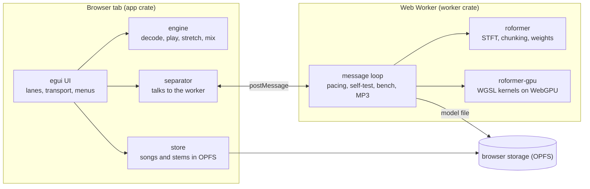
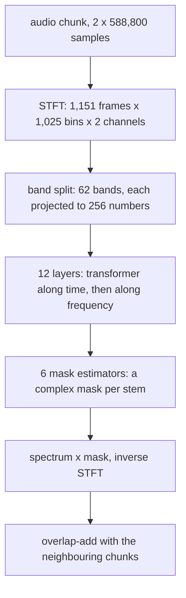

# How Stemyla works

Stemyla is a Rust workspace compiled to WebAssembly.  The page has two parts: the app on the page's main thread (drawing, playback, storage) and a Web Worker that runs the separation model on the GPU through WebGPU.  Nothing is sent to a server; the only network use is downloading the page and, once, the model.

## Crates

* `dsp`: small audio functions (peaks, mixing, median, fades, loop wrapping) written in a deliberately plain style, loops and indexing only, as a first reading exercise.
* `engine`: decoding (Symphonia), the player and mixer, pitch-preserving time-stretch (WSOLA), the classic drum separation (harmonic/percussive median filtering), and a 16-bit WAV writer.
* `synth`: the built-in demo song, synthesised so its stems are known exactly.
* `app`: the egui interface.  Natively it plays through cpal; on the web through Web Audio.  `separator.rs` drives the worker; `store.rs` keeps songs and stems in the browser.
* `roformer`: everything about the model except the GPU: STFT and inverse STFT, cutting a song into overlapping chunks and joining the results (as the reference Python does), reading the weights (f32, f16 or bf16 safetensors), and a CPU implementation of the network on Burn's ndarray backend.  The CPU version is the reference the GPU is tested against.
* `roformer-gpu`: the network on WebGPU with hand-written WGSL kernels, driven by wgpu.
* `worker`: the Web Worker: loads or downloads the model, opens the GPU, runs separations, the self-test, the benchmark and MP3 encoding.
* `xtask`: tools run with Cargo: the static file server, model conversion, CPU separation, self-test reference files, the demo song generator, benchmarks.

## The model

BS-RoFormer SW separates a stereo 44.1 kHz song into six stems: bass, drums, other, vocals, guitar and piano.  For each 13.35 s chunk:

A chunk is about 6.1 TFLOP of arithmetic, nearly all of it matrix multiplication.  The 212 s test song is 34 chunks.

## Running it on the GPU

`roformer-gpu` has four WGSL files: a matrix multiply (strided, batched, with bias, GELU or tanh, and accumulate), row softmax, RMS normalisation, and small element-wise kernels (rotary position embedding, attention gates, transpose, gated linear unit).  The design rules:

* **Portable limits.**  Every kernel fits WebGPU's default limits (256 threads per workgroup, 16 KiB of workgroup memory, 128 MiB per buffer binding), and the device is requested with exactly those, so nothing depends on what one GPU offers beyond them.
* **Short steps.**  A chunk is split into about 1,000 steps, each one short command buffer (for example one band of one time transformer, about 5 GFLOP).  The worker waits for the GPU after every step, so the display never waits long, and stops the run if a step takes over 5 s.  The operating system's GPU watchdog is never approached.
* **Kernels checked on every GPU.**  When the GPU opens, every matrix-multiply kernel runs two small products and is compared with the CPU.  A kernel that disagrees is not used on that GPU.
* **Kernels chosen per GPU.**  There are five matrix-multiply kernels with different tile shapes.  The fastest differs by GPU (the original kernel is the fastest on a Radeon Pro 5500M and the slowest, by a factor of 5, on an Intel UHD 630), so each GPU times the checked kernels once, for a few seconds, and the choice is kept in browser storage.
* **Self-test.**  `?selftest` compares each stage of the network, and one full chunk, with reference files made by the CPU version (`xtask roformer-selftest`).

## Browser storage

The page uses the browser's private file system (OPFS):

* `bs_roformer_sw.safetensors`: the model, downloaded or picked once.
* `matmul_kernels`: the kernel choice per GPU.
* `sessions/<id>/`: one per dropped song: the files as dropped (`src/`), its separated stems as 16-bit WAVs (`stems/`), and a small `meta` file.  `sessions/current` names the one shown last; a reload restores it without separating again.

The Storage menu lists the stored songs, opens or forgets one, shows the space used, and can remove the model.

## Tests

* `cargo test --workspace`: unit and integration tests, including the UI snapshots.
* `cargo test -p roformer --release`: the CPU network against PyTorch (needs fixtures from `tools/roformer_export.py`; skipped without them).
* `cargo test -p roformer-gpu --release`: every GPU kernel against CPU loops, and the whole network against PyTorch.  Without a GPU, point Vulkan at SwiftShader (see the README).
* `tools/*.mjs`: headless Chromium checks of the built page (self-test, worker against PyTorch, storage, benchmark), using Playwright.
