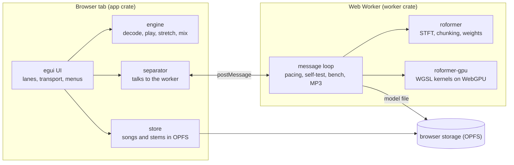
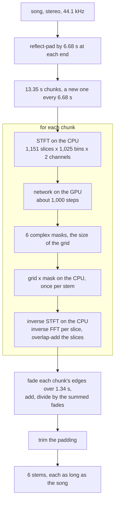
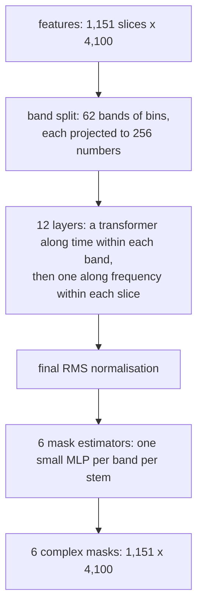
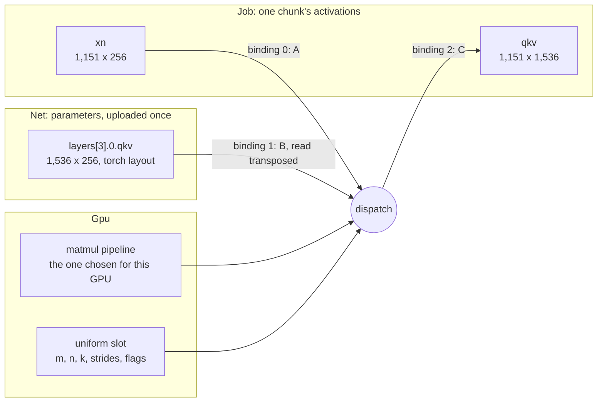

# How Stemyla works

Stemyla is a Rust workspace compiled to WebAssembly.  The page has two parts: the app on the page's main thread (drawing, playback, storage) and a Web Worker that runs the separation model on the GPU through WebGPU.  Nothing is sent to a server; the only network use is downloading the page and, once, the model.



## Crates

* `dsp`: small audio functions (peaks, mixing, median, fades, loop wrapping) written in a deliberately plain style, loops and indexing only, as a first reading exercise.
* `engine`: decoding (Symphonia), the player and mixer, pitch-preserving time-stretch (WSOLA), the classic drum separation (harmonic/percussive median filtering), and a 16-bit WAV writer.
* `synth`: the built-in demo song, synthesised so its stems are known exactly.
* `app`: the egui interface.  Natively it plays through cpal; on the web through Web Audio.  `separator.rs` drives the worker; `store.rs` keeps songs and stems in the browser.
* `roformer`: everything about the model except the GPU: STFT and inverse STFT, cutting a song into overlapping chunks and joining the results (as the reference Python does), reading the weights (f32, f16 or bf16 safetensors), and a CPU implementation of the network on Burn's ndarray backend.  The CPU version is the reference the GPU is tested against.
* `roformer-gpu`: the network on WebGPU with hand-written WGSL kernels, driven by wgpu.
* `worker`: the Web Worker: loads or downloads the model, opens the GPU, runs separations, the self-test, the benchmark and MP3 encoding.
* `xtask`: tools run with Cargo: the static file server, model conversion, CPU separation, self-test reference files, the demo song generator, benchmarks.

## From a song to six stems

A song is handled in chunks of 13.35 s (588,800 samples), and a new chunk starts every 6.68 s, so every sample lies in two chunks.  The song is first reflect-padded by 6.68 s at each end, so its first and last seconds are covered twice as well.  For each chunk:

1. The STFT, on the CPU, turns each channel into a grid of 1,151 time slices by 1,025 frequency bins.  Each slice is a 2,048-sample (46 ms) Hann window, and the window moves 512 samples (11.6 ms) at a time, so neighbouring slices overlap by 75 %.  Each cell is a complex number: its magnitude is how loud that frequency is in that slice, its phase where it is in its cycle.  The two channels' grids are flattened into the network input, 4,100 numbers per slice.
2. The network, on the GPU, takes the whole grid in one run of about 1,000 GPU steps and returns six masks of the same size, one per stem.  It needs the whole grid at once because its time transformers compare all 1,151 slices of a band with each other.
3. Back on the CPU, the mix's grid is multiplied cell by cell by each mask (a complex multiply, so both loudness and phase change), and the inverse STFT turns each masked grid back into 13.35 s of audio: an inverse FFT per slice, then an overlap-add of the slices.

Each chunk's six stems are faded in and out over 1.34 s at their edges (no fade-in on the first chunk, no fade-out on the last), added into song-length buffers, and divided by the summed fade weights, which crossfades neighbouring chunks.  Trimming the padding leaves six stems as long as the song.  So there are overlaps at two scales, each undone by its own overlap-add: 75 % between slices within a chunk, and 50 % between chunks across the song.  `roformer::demix::Demixer` does the chunking and crossfading as `bs_roformer.utils.demix_track` in the reference Python does, and `roformer::stft` follows `torch.stft` and `torch.istft`.



## The model

BS-RoFormer SW separates a stereo 44.1 kHz song into six stems: bass, drums, other, vocals, guitar and piano.  Inside the network, one chunk's grid goes through:



The bands are narrow at low frequencies, 2 bins (43 Hz) each up to 1 kHz, and wide at the top: 48 bins each up to 16.5 kHz, then two bands of 128 and 129 bins.  A chunk is about 6.1 TFLOP of arithmetic, nearly all of it matrix multiplication.  The 212 s test song is 34 chunks.

The parameters and the arithmetic are spread very unevenly:

| Part | Parameters | Matmul work per chunk |
| - | - | - |
| band split | 1.07 M (0.6 %) | 2.4 GFLOP (0.04 %) |
| 24 transformer blocks | 25.26 M (14.5 %) | 5,726 GFLOP (94.3 %) |
| 6 mask estimators | 148.33 M (84.9 %) | 341 GFLOP (5.6 %) |
| total | 174.66 M (about 699 MB as f32) | 6,069 GFLOP |

The cause is reuse.  Each transformer weight is applied to every token of a chunk, 1,151 slices times 62 bands, on top of the attention products, which use no weights at all.  Each mask estimator has its own MLP per band, and that MLP sees only its band's 1,151 slices.

## Running it on the GPU

`roformer-gpu` has five WGSL files: two matrix multiplies, the original and a template for its register-tiled variants (strided, batched, with bias, GELU or tanh, and accumulate), row softmax, RMS normalisation, and small element-wise kernels (rotary position embedding, attention gates, transpose, gated linear unit).  The design rules:

* **Portable limits.**  Every kernel fits WebGPU's default limits (256 threads per workgroup, 16 KiB of workgroup memory, 128 MiB per buffer binding), and the device is requested with exactly those, so nothing depends on what one GPU offers beyond them.
* **Short steps.**  A chunk is split into about 1,000 steps, each one short command buffer (for example one band of one time transformer, about 5 GFLOP).  The worker waits for the GPU after every step, so the display never waits long, and stops the run if a step takes over 5 s.  The operating system's GPU watchdog is never approached.
* **Kernels checked on every GPU.**  When the GPU opens, every matrix-multiply kernel runs two small products and is compared with the CPU.  A kernel that disagrees is not used on that GPU.
* **Kernels chosen per GPU.**  There are five matrix-multiply kernels with different tile shapes.  The fastest differs by GPU (the original kernel is the fastest on a Radeon Pro 5500M and the slowest, by a factor of 5, on an Intel UHD 630), so each GPU times the checked kernels once, for a few seconds, and the choice is kept in browser storage.
* **Self-test.**  `?selftest` compares each stage of the network, and one full chunk, with reference files made by the CPU version (`xtask roformer-selftest`).

### How `net.rs` drives the kernels

The WGSL kernels know almost nothing about BS-RoFormer.  The matmul kernels multiply two strided matrices, with an optional bias, GELU or tanh, scale and accumulate, and the softmax kernel normalises rows; both work on any shape.  The smaller kernels do fix some of the network's sizes: `rope` assumes rows of 1,536 holding 8 heads of 32 pairs, `gate` 8 heads of 64, `rmsnorm` and `transpose3` a width of 256, and `glu` rows of 4,100.

The architecture lives in `roformer-gpu/src/net.rs`, in four forms:

* Parameters: `Net::load` asks the safetensors file for every tensor by its PyTorch name and shape, and `Store::finish` rejects a file that holds any tensor it did not ask for.  Some are adjusted for the kernels on the way in.  RMSNorm gains are multiplied by √width once, so the kernel computes only `x / |x| * g`.  Band-split weights are stacked per band group.  The band-split norm gains stay on the CPU, where `Job::set_input` applies them.
* Dataflow: `Job::steps` gives the order across the network and `Job::transformer` the order inside one block, one dispatch per line of the maths.
* Layouts: the hidden state is `[62, T, 256]` for time attention and `[T, 62, 256]` for frequency attention, `qkv` is packed as `[q | k | v]` with 8 heads of 64 in each, and the mask is `[T, 4100]`.  Each matmul's `View` strides encode these layouts, so weights stay in torch's `[out, in]` layout and are read transposed, and each head's q, k and v are read straight out of `qkv` without a copy.
* Sizes: the constants in `roformer/src/lib.rs` (`DIM`, `HEADS`, `DIM_HEAD`, `DEPTH`, `HIDDEN`, `FREQS_PER_BANDS`).

To the GPU, parameters and activations are both just storage buffers.  `Net` owns the parameters, uploaded once and never written again.  `Job` owns one chunk's activations, rewritten at every step.  A dispatch combines a pipeline (which kernel), a bind group (which buffers), a 256-byte slot of the uniform buffer (shapes, strides, bias, activation, scale, accumulate) and a grid of workgroups.  Here is the query, key and value projection of layer 3's time transformer:



The same pipeline runs every matrix product in the network, only with other bindings.  In layer 11 the weight binding is `layers[11].0.qkv`.  For the attention scores both operands are views into `qkv`, so no parameter is involved.  For the mask estimators the weight is one band group's stacked MLPs, batched over the bands through a batch stride.  The attention scores, softmax, `P·v`, rotary embedding and transposes all run on activations only.

A time-transformer step is the most common kind (744 per chunk).  It runs 12 dispatches on one band's `[1151, 256]` slice of the hidden state `x`, updated in place:

```text
 1  rmsnorm  attn_norm                     -> xn      [1151, 256]
 2  matmul   xn . Wqkv^T                   -> qkv     [1151, 1536]
 3  rope     q and k, in place             -> qkv
 4  matmul   xn . Wgates^T + b             -> gates   [1151, 8]
 5  matmul   q . k^T / 8, per head         -> scores  [8, 1151, 1151]
 6  softmax  rows                          -> scores
 7  matmul   P . v, per head               -> o       [1151, 512]
 8  gate     o * sigmoid(gates)            -> o
 9  matmul   o . Wout^T, accumulate        -> x       (residual)
10  rmsnorm  ff_norm                       -> xn
11  matmul   xn . W1^T + b1, GELU          -> h       [1151, 1024]
12  matmul   h . W2^T + b2, accumulate     -> x       (residual)
```

The worker (`worker/src/web.rs`) paces the steps.  It submits one, waits for the GPU, checks the time taken and any WebGPU error, then goes on, and it reads a stem's mask back when that stem's last mask step finishes.  `Job::masks` does the same without the pacing, for tests and native runs.

What a change to the model would touch:

* Another checkpoint of the same configuration: only the weights file.
* More or fewer layers: `DEPTH`.
* Other heads or width: the constants in `roformer/src/lib.rs`, and the fixed sizes in `elementwise.wgsl` and `rmsnorm.wgsl`.
* Another band split: `FREQS_PER_BANDS`, and the 4,100 in `glu`.
* A new operation, such as SiLU in place of GELU: a branch in the matmul epilogue, a variant of `Act`, and CPU checks for it.

## Browser storage

The page uses the browser's private file system (OPFS):

* `bs_roformer_sw.safetensors`: the model, downloaded or picked once.
* `matmul_kernels`: the kernel choice per GPU.
* `sessions/<id>/`: one per dropped song: the files as dropped (`src/`), its separated stems as 16-bit WAVs (`stems/`), and a small `meta` file.  `sessions/current` names the one shown last; a reload restores it without separating again.

The Storage menu lists the stored songs, opens or forgets one, shows the space used, and can remove the model.

## Tests

* `cargo test --workspace`: unit and integration tests, including the UI snapshots.
* `cargo test -p roformer --release`: the CPU network against PyTorch (needs fixtures from `tools/roformer_export.py`; skipped without them).
* `cargo test -p roformer-gpu --release`: every GPU kernel against CPU loops, and the whole network against PyTorch.  Without a GPU, point Vulkan at SwiftShader (see the README).
* `tools/*.mjs`: headless Chromium checks of the built page (self-test, worker against PyTorch, storage, benchmark), using Playwright.
