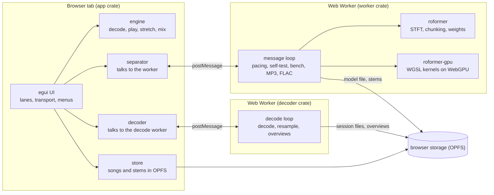
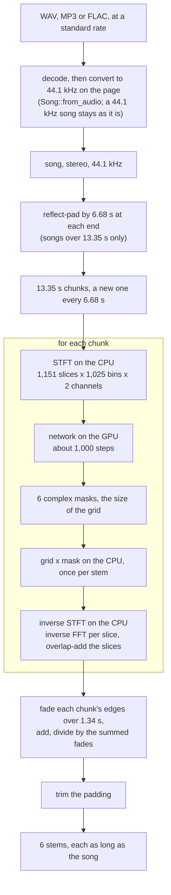
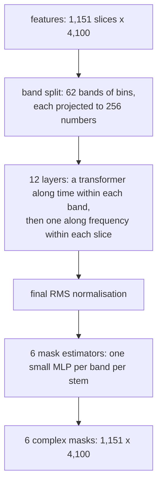
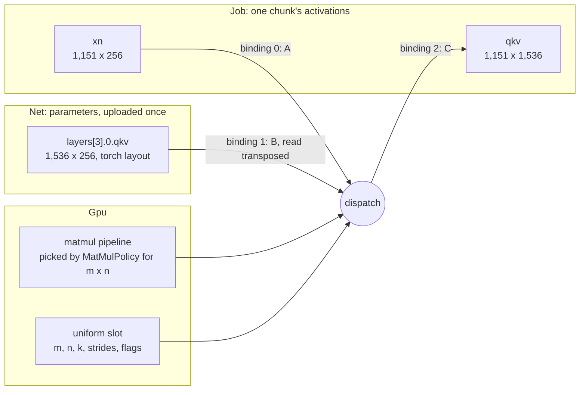
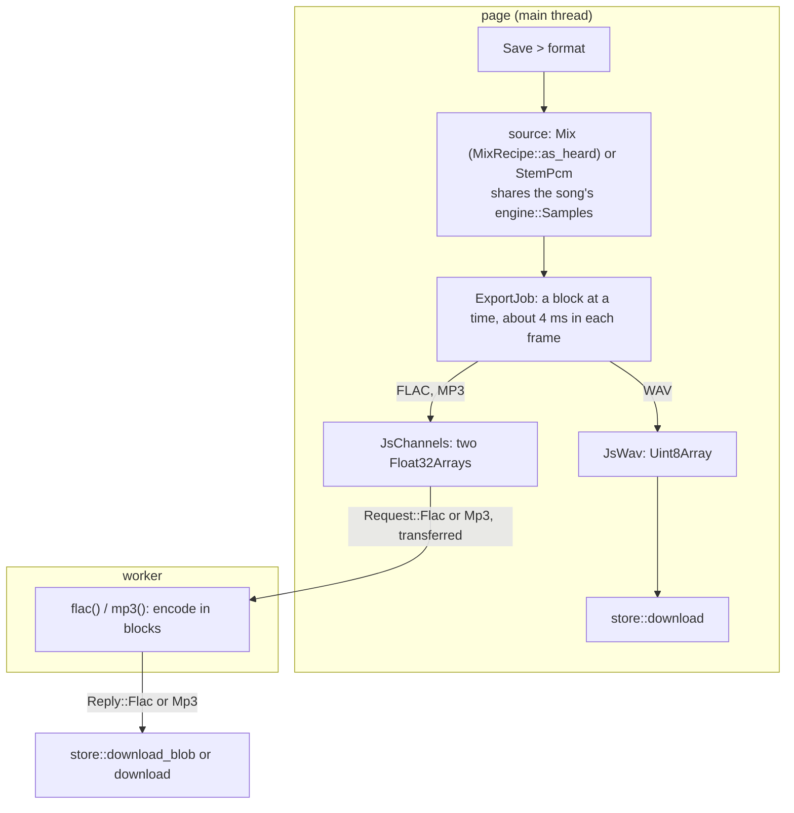

# How Stemyla works

Stemyla is a Rust workspace compiled to WebAssembly.  The page has three parts: the app on the page's main thread (drawing, playback, storage), a Web Worker that runs the separation model on the GPU through WebGPU, and a Web Worker that decodes a stored song into session files (the decode worker, decision 0019).  Nothing is sent to a server; the only network use is downloading the page and, once, the model.  Terms such as STFT, mask or workgroup are explained under [Vocabulary](#vocabulary).



## Crates

* `dsp`: small audio functions (peaks, mixing, median, fades, loop wrapping) written in a deliberately plain style, loops and indexing only, as a first reading exercise.
* `engine`: decoding of WAV, MP3 and FLAC (Symphonia), with at most 1 GiB of samples from each file (decision 0013).  It also converts each song to 44.1 kHz (`engine::resample`, decision 0012).  It can decode a source in blocks into a sink, with the samples of a whole decode, bit for bit (`engine::decode::Decoder`, `engine::resample::Resampler`, `engine::song::decode_into`).  `engine::overview` makes the waveform columns of a lane, from whole channels or from blocks.  It has the player and mixer, pitch-preserving time-stretch (WSOLA), the classic drum separation (harmonic/percussive median filtering), and a 16-bit WAV writer.  `engine::mixdown` reads a stem or a mix of stems one block at a time.
* `synth`: the built-in demo song, synthesised so its stems are known exactly.  Its `files` feature adds writers for the song's WAV files and `truth.json`, for tools and tests.
* `app`: the egui interface.  Natively it plays through cpal; on the web through Web Audio.  `separator.rs` drives the worker; `store.rs` keeps songs and stems in the browser.
* `roformer`: everything about the model except the GPU: STFT and inverse STFT, cutting a song into overlapping chunks and joining the results (as the reference Python does), reading the weights (f32, f16 or bf16 safetensors), and a CPU implementation of the network on Burn's ndarray backend.  The CPU version is the reference the GPU is tested against.
* `roformer-gpu`: the network on WebGPU with hand-written WGSL kernels, driven by wgpu.
* `stem-worker` (`worker/`): the Web Worker: loads or downloads the model, opens the GPU, runs separations, the self-test, the benchmark, and MP3 and FLAC encoding.
* `decode-worker` (`decoder/`): the page-side Web Worker (decision 0019).  It decodes a song that the page keeps in browser storage, in blocks, with `engine`, and writes the session files and the overviews as `.decode.part` files, in blocks of 1 MiB (`decode_worker::pass`).  It answers each `decode` request of `stem_protocol::decode` with `decoded`, `undecodable` or `decode-unstored`.  The page starts it at the first open (`app::decoder`), and reads the session files back to show the song.
* `stem-protocol` (`protocol/`): the messages between the page and its workers, one encoder and one decoder per message, shared by both sides.
* `test-support`: `skip`, which a test calls when it has no GPU adapter, no adapter feature or no fixture.  It prints a skip line, or panics when `STEMYLA_REQUIRE` lists that need (VERIFY-1).  It is only a dev-dependency.
* `xtask`: tools run with Cargo: the static file server, the browser test runners (`web-test`, `e2e`), the docs check (`docs-check`), the review round tools (`review`), publishing, model conversion, CPU separation, self-test reference files, the demo song generator, benchmarks.

### Layers

Each workspace crate depends only on the workspace crates that its row lists, and on `test-support` as a dev-dependency (LAYER-1 in `docs/invariants.md`).  Each listed crate is in a lower layer.  The page side (`app` and `decode-worker`) and the worker side (`stem-worker`) meet only through `stem-protocol`.  The workspace crates that `stem-worker` reaches through normal dependencies, for any target, have only `stem-protocol` in common with those that `app` or `decode-worker` reaches.

| Layer | Crate | Depends on |
| - | - | - |
| Test support | `test-support` | no workspace crate |
| Pure | `dsp` | no workspace crate |
| Pure | `synth` | no workspace crate |
| Pure | `roformer` | no workspace crate |
| Pure | `stem-protocol` | no workspace crate |
| Engine and GPU | `engine` | `dsp` |
| Engine and GPU | `roformer-gpu` | `roformer` |
| Shells | `app` | `dsp`, `engine`, `stem-protocol`, `synth` |
| Shells | `decode-worker` | `dsp`, `engine`, `stem-protocol` |
| Shells | `stem-worker` | `roformer`, `roformer-gpu`, `stem-protocol` |
| Tools | `xtask` | `dsp`, `engine`, `roformer`, `synth` |

The rows run from the lowest layer to the highest.  Each row lists every workspace crate that its crate depends on, dev- and build-dependencies included, apart from `test-support`.  `crates_depend_only_downwards` compares the table with `cargo metadata`.  Change the table in the commit that adds or removes a crate, or a dependency between crates.  Every path crate in the build is a workspace crate with a row.  No crate from a registry or git has a workspace crate's name, or takes a workspace crate.  The layers are those of LAYER-1, and `LAYERS` in `xtask/src/rules.rs` holds them.

Any crate but `dsp` (DSP-1) may take `test-support` as a dev-dependency.  No crate may take it as a normal or build dependency: it is a dev-dependency only, so it never ships.  It takes no workspace crate.

`app` takes `synth` as a normal dependency without its `files` feature, so `synth` brings no other crate into the web app (`app`, `decode-worker` and `stem-worker`; LAYER-1).

## From a song to six stems

The model takes only 44.1 kHz.  So `Song::from_audio` converts a song at another common rate, from 8 kHz to 384 kHz, to 44.1 kHz when the page opens it (decision 0012).  The converter is a polyphase windowed-sinc filter with 64 taps at 48 kHz, flat to 20 kHz.  It refuses other rates, because a file's header can state any rate.  A 44.1 kHz song stays as it is, with no copy.

A song is handled in chunks of 13.35 s (588,800 samples), and a new chunk starts every 6.68 s (294,400 samples), so every sample away from the ends lies in two chunks.  A song longer than 13.35 s is first reflect-padded by 6.68 s at each end, so its first and last seconds are covered twice as well.  `Demixer::new` skips that padding for a song of 13.35 s or less, so its first 6.68 s lie in one chunk only, which keeps full weight there because the first chunk has no fade-in.  For each chunk:

1. The STFT, on the CPU, turns each channel into a grid of 1,151 time slices by 1,025 frequency bins.  Each slice is a 2,048-sample (46 ms) Hann window, and the window moves 512 samples (11.6 ms) at a time, so neighbouring slices overlap by 75 %.  Each cell is a complex number: its magnitude is how loud that frequency is in that slice, its phase where it is in its cycle.  The two channels' grids are flattened into the network input, 4,100 numbers per slice.
2. The network, on the GPU, takes the whole grid in one run of about 1,000 GPU steps and returns six masks of the same size, one per stem.  It needs the whole grid at once because its time transformers compare all 1,151 slices of a band with each other.
3. Back on the CPU, the mix's grid is multiplied cell by cell by each mask (a complex multiply, so both loudness and phase change), and the inverse STFT turns each masked grid back into 13.35 s of audio: an inverse FFT per slice, then an overlap-add of the slices.

Each chunk's six stems are faded in and out over 1.34 s at their edges (no fade-in on the first chunk, no fade-out on the last), added into running sums, and divided by the summed fade weights, which crossfades neighbouring chunks.  Trimming the padding leaves six stems as long as the song.  A sample gets nothing more once the next chunk has started past it, so after each chunk the worker divides the finished 6.68 s of every stem and sends it to the page, which fills in the song-length stems.  The worker thus holds about one chunk of running sums (28 MB) instead of six songs, and the reflect padding is read through an index rather than copied.  So there are overlaps at two scales, each undone by its own overlap-add: 75 % between slices within a chunk, and 50 % between chunks across the song.  `roformer::demix::Demixer` does the chunking and crossfading as `bs_roformer.utils.demix_track` in the reference Python does, and `roformer::stft` follows `torch.stft` and `torch.istft`.



## The model

BS-RoFormer SW separates a stereo 44.1 kHz song into six stems: bass, drums, other, vocals, guitar and piano.  Inside the network, one chunk's grid goes through:



The bands are narrow at low frequencies, 2 bins (43 Hz) each up to 1 kHz, and wide at the top: 48 bins each up to 16.5 kHz, then two bands of 128 and 129 bins.  A chunk is about 6.1 TFLOP of arithmetic, nearly all of it matrix multiplication.  The 212 s test song is 34 chunks.

The parameters and the arithmetic are spread very unevenly:

| Part | Parameters | Matmul work per chunk |
| - | - | - |
| band split | 1.07 M (0.6 %) | 2.4 GFLOP (0.04 %) |
| 24 transformer blocks | 25.26 M (14.5 %) | 5,726 GFLOP (94.3 %) |
| 6 mask estimators | 148.33 M (84.9 %) | 341 GFLOP (5.6 %) |
| total | 174.66 M (about 699 MB as f32) | 6,069 GFLOP |

The cause is reuse.  Each transformer weight is applied to every token of a chunk, 1,151 slices times 62 bands, on top of the attention products, which use no weights at all.  Each mask estimator has its own MLP per band, and that MLP sees only its band's 1,151 slices.

## Memory on phones

iOS stops a browser tab whose memory passes a fixed limit, 2 GB on an iPhone 17 Pro however much memory is free, and counts the page's GPU buffers towards it.  An iPad allows more.  A file decodes to at most 1 GiB of `f32` samples (`engine::decode::MAX_DECODED_BYTES`, decision 0013).  A FLAC of about 80 kB can hold 2 hours of silence.  A mono file counts as stereo.  While a channel grows, a realloc can briefly hold about 1.5 times the limit.  A WAV or FLAC whose header states more is refused before it decodes.  An MP3 often states only an estimate, so it stops at the limit while it decodes.  The parameters take about 700 MB as f32 on the GPU and one chunk's activations about 280 MB with fused attention, so the rest is kept small: the model is read into the worker one tensor at a time (`roformer::weights::Source`), never whole into WebAssembly memory, which never shrinks.  A picked file is first checked, then copied into browser storage 8 MB at a time, and the model is built from that copy, so the stored model is the one loaded (when storage cannot take the copy, the model is built from the picked file and not saved).  The stored model is read straight from the file with `FileReaderSync`, in 8 MB blocks of which the last 8 are kept, so JavaScript holds about 64 MB of it; only a fresh download checked against its SHA-256 is read whole first, since WebCrypto hashes only whole buffers, and the model is built from the bytes that were hashed (Safari reads a stored file as it is when read, not as it was when opened).  GPU memory is freed when its owner is dropped, not when JavaScript gets round to it: wgpu's web backend does nothing when a buffer is dropped, and Safari's garbage collector has not been told how much memory WebGPU objects hold ([WebKit bug 283321](https://bugs.webkit.org/show_bug.cgi?id=283321)), so every buffer `roformer-gpu` makes is a `GpuBuffer`, which calls `destroy()` when dropped.  A replaced or forgotten model, a chunk's buffers, a model upload that fails part-way, every readback and every calibration buffer are freed as soon as they are dropped: the old model is dropped before a new one is uploaded (once the new file parses and the GPU opens), and a chunk's buffers before the next chunk's are made, so neither is ever on the GPU twice.  `Rec` borrows the buffers it binds until it is submitted, so none is destroyed while a recorded dispatch still needs it.  A separation takes one of two paths (M3 of `plans/active/stream-from-storage.md`).  On the storage path, the page first writes the song's mix to a session file in blocks (M4), and the request names that file.  The worker reads it one chunk at a time, so its memory does not grow with the song.  It writes each stem to its session file as it separates, and no samples cross between the page and the worker.  On the memory path, the stems leave the worker chunk by chunk, and the page puts them together (`app::assemble`).  The page takes the memory path for a song without a session, or when storage has too little free space.  It also takes it when storage refuses the mix or the stems, or the worker cannot read the mix file.  When the song has a session but takes the memory path, the page does not keep the stems.  On the memory path, the page refuses a song over 100 seconds (`app::MEMORY_PATH_MAX_FRAMES`), because six song-length stems on the page stop the tab on an iPhone (TD-54).  After a storage-path separation, the page reads the stems back from their files, one stem at a time, to show them.  On the page, a stem's samples are immutable shared buffers (`engine::Samples`), so showing separated stems, saving them in browser storage and keeping them for a song being opened share one copy instead of making one each.  The audio output is opened once and kept, and each song's player is swapped into it (`engine::slot`): cpal's Web Audio host never frees a stream's callback, so a stream per song kept every replaced song alive.  The worker logs its WebAssembly memory, the GPU parameters, the chunk buffers and the GPU buffers still allocated (`Gpu::live_bytes`, flat from chunk to chunk of the same length unless one leaks) when the model loads and after every chunk (`memory: ...` in the console), and the page logs its own WebAssembly memory before it writes the mix, as a separation starts, as it ends and once separated stems are shown.  The worker also logs its WebAssembly memory at the start of each separation, and at the end of each separation that finishes.

## Running it on the GPU

`roformer-gpu` has seven WGSL files: matrix multiplies (strided, batched, with bias, GELU or tanh, and accumulate), one template generated in two tile shapes, a vec4 variant of it and the original hand-written kernel; fused attention (scores, softmax, weighted sum of values and gate in one dispatch); row softmax; RMS normalisation; and small element-wise kernels (rotary position embedding, attention gates, transpose, gated linear unit).  The design rules:

* **Portable limits.**  Every kernel fits WebGPU's default limits (256 threads per workgroup, 16 KiB of workgroup memory, 128 MiB per buffer binding), and the device is requested with exactly those, so nothing depends on what one GPU offers beyond them.
* **Code any GPU compiler handles well.**  Each thread keeps its running sums in separately named variables (an array indexed in a loop ran 5 to 6 times slower on Intel and Apple GPUs), neighbouring threads read neighbouring numbers from shared memory and global memory, and each shared-memory read feeds at least two multiply-adds.
* **Short steps.**  A chunk is split into a few hundred steps, each one short command buffer (for example four bands of one time transformer).  The worker waits for the GPU after every step, so the display never waits long, and stops the run if a step takes over 5 s.  The operating system's GPU watchdog is never approached.
* **Kernels checked on every GPU.**  When the GPU opens, every matrix-multiply kernel and fused attention run small cases and are compared with the CPU.  A kernel that disagrees is not used on that GPU.
* **What varies by GPU is measured, once.**  The two generated matrix-multiply shapes differ only in how many outputs each thread keeps in registers (4 x 4 or 8 x 4): more gets more out of each shared-memory read, fewer lets more threads run at once.  Which wins depends on the GPU's register file, which WebGPU does not report (the Radeon Pro 5500M prefers 4 x 4, the Intel UHD 630 8 x 4).  The original kernel is a third candidate: it keeps its sums in a loop-indexed array, which only some compilers turn into registers (fastest on the Radeon, 5 to 6 times slower on Intel and Apple GPUs, where the measurement drops it after one round).  The vec4 variant is a fourth: the same 64 x 64 tile as the 4 x 4 shape, but it reads both operands four floats at a time, a quarter of the shared-memory reads per multiply-add.  It runs only products whose operands are K-contiguous with K, offsets and strides multiples of 4 (every linear layer and the attention scores), and hands the rest to the 4 x 4 kernel; in Safari and Chrome on the Radeon Pro 5500M it was the fastest kernel on every product it runs.  Fused attention is used on the frequency axis everywhere (2 to 4 times faster on every GPU measured), and on the time axis unless the separate kernels measured more than 10% faster (Apple GPUs fused, the UHD 630 split).  Each GPU times these choices once, for several seconds once it has done real work (after the model is loaded, or after `?bench`'s matmul timings), and keeps the result in browser storage.
* **Self-test.**  `?selftest` compares each stage of the network, and one full chunk, with reference files made by the CPU version (`xtask roformer-selftest`).

### How `net.rs` drives the kernels

The WGSL kernels know almost nothing about BS-RoFormer.  The matmul kernels multiply two strided matrices, with an optional bias, GELU or tanh, scale and accumulate, and the softmax kernel normalises rows; both work on any shape.  The smaller kernels do fix some of the network's sizes: `rope` assumes rows of 1,536 holding 8 heads of 32 pairs, `gate` 8 heads of 64, `rmsnorm` and `transpose3` a width of 256, and `glu` rows of 4,100.

The architecture lives in `roformer-gpu/src/net.rs`, in four forms:

* Parameters: `Net::load` asks the safetensors file for every tensor by its PyTorch name and shape, and `Store::finish` rejects a file that holds any tensor it did not ask for.  Some are adjusted for the kernels on the way in.  RMSNorm gains are multiplied by √width once, so the kernel computes only `x / |x| * g`.  Band-split weights are stacked per band group.  The band-split norm gains stay on the CPU, where `Job::set_input` applies them.
* Dataflow: `Job::steps` gives the order across the network and `Job::transformer` the order inside one block, one dispatch per line of the maths.
* Layouts: the hidden state is `[62, T, 256]` for time attention and `[T, 62, 256]` for frequency attention, `qkv` is packed as `[q | k | v]` with 8 heads of 64 in each, and the mask is `[T, 4100]`.  Each matmul's `View` strides encode these layouts, so weights stay in torch's `[out, in]` layout and are read transposed, and each head's q, k and v are read straight out of `qkv` without a copy.
* Sizes: the constants in `roformer/src/lib.rs` (`DIM`, `HEADS`, `DIM_HEAD`, `DEPTH`, `HIDDEN`, `FREQS_PER_BANDS`).

To the GPU, parameters and activations are both just storage buffers.  `Net` owns the parameters, uploaded once and never written again.  `Job` owns one chunk's activations, rewritten at every step.  A dispatch combines a pipeline (which kernel), a bind group (which buffers), a 256-byte slot of the uniform buffer (shapes, strides, bias, activation, scale, accumulate) and a grid of workgroups.  Here is the query, key and value projection of layer 3's time transformer:



Every matrix product in the network goes through the same `Rec::matmul` interface and the same tiled kernel, only with other bindings and uniforms.  Which tile shape runs is decided per product: `MatMulPolicy::pick` returns one fixed shape, or, for a `Split` policy, the `large` one when both sides of the output exceed 64 and the `small` one otherwise (gates, and `P·v` in split attention).  In layer 11 the weight binding is `layers[11].0.qkv`.  For the attention scores both operands are views into `qkv`, so no parameter is involved.  For the mask estimators the weight is one band group's stacked MLPs, batched over the bands through a batch stride.  The attention scores, softmax, `P·v`, rotary embedding and transposes all run on activations only.

A time-transformer step with split attention runs 12 dispatches on one band's `[1151, 256]` slice of the hidden state `x`, updated in place (744 such steps per chunk).  With fused attention, dispatches 5 to 8 become one, and since there is no scores buffer a step takes four bands (186 steps per chunk):

```text
 1  rmsnorm  attn_norm                     -> xn      [1151, 256]
 2  matmul   xn . Wqkv^T                   -> qkv     [1151, 1536]
 3  rope     q and k, in place             -> qkv
 4  matmul   xn . Wgates^T + b             -> gates   [1151, 8]
 5  matmul   q . k^T / 8, per head         -> scores  [8, 1151, 1151]
 6  softmax  rows                          -> scores
 7  matmul   P . v, per head               -> o       [1151, 512]
 8  gate     o * sigmoid(gates)            -> o
 9  matmul   o . Wout^T, accumulate        -> x       (residual)
10  rmsnorm  ff_norm                       -> xn
11  matmul   xn . W1^T + b1, GELU          -> h       [1151, 1024]
12  matmul   h . W2^T + b2, accumulate     -> x       (residual)
```

The worker (`worker/src/web.rs`) paces the steps.  It submits one, waits for the GPU, checks the time taken and any WebGPU error, then goes on, and it reads a stem's mask back when that stem's last mask step finishes.  `Job::masks` does the same without the pacing, for tests and native runs.

What a change to the model would touch:

* Another checkpoint of the same configuration: only the weights file.
* More or fewer layers: `DEPTH`.
* Other heads or width: the constants in `roformer/src/lib.rs`, and the fixed sizes in `elementwise.wgsl` and `rmsnorm.wgsl`.
* Another band split: `FREQS_PER_BANDS`, and the group and band counts asserted in its test.  Every valid split still sums to 1,025 bins, so `FEATURES` stays 4,100.
* Another STFT size: `N_FFT`, a `FREQS_PER_BANDS` that sums to the new `BINS`, and the 4,100 in `glu`, which is `FEATURES = BINS * CHANNELS * 2`.
* A new operation, such as SiLU in place of GELU: a branch in the matmul epilogue, a variant of `Act`, and CPU checks for it.

Any change to the shapes also touches `roformer-gpu/src/bench.rs`, whose kernel calibration and benchmark hard-code this model's matrix sizes and step counts.

## Saving a stem or the mix

Each lane's "Save" menu saves its stem.  The mix lane's menu saves the mix as heard, at 100% tempo (decision 0014).  Each stem has its gain after Mute, Solo and volume, and the sum is clamped to ±1.  The mix lane's subtitle names the stems in that mix.  Its waveform and spectrogram follow the mix, through the same blocks (`app::export::MixFollower`).

A save is an `app::export::ExportJob`.  It reads its source (`engine::mixdown::Mix` or `StemPcm`) in blocks of 16,384 frames, and writes each block to a sink.  On the web, the main thread also fills the Web Audio buffers, so the job runs for about 4 ms in each UI frame.  The sinks write into JS arrays, so WebAssembly memory holds only the blocks (MEM-1, MEM-4).  A WAV is made on the page.  The worker encodes FLAC and MP3 from the two transferred `Float32Array`s (MEM-2), with the same messages as for a stem.



The page mixes, not the worker.  The stems are on the page, and the worker does not keep them.  To mix in the worker, the page would copy every stem to JS.  And `app` and `stem-worker` may share only `stem-protocol` (LAYER-1).

## Browser storage

The page uses the browser's private file system (OPFS):

* `bs_roformer_sw.safetensors`: the model, downloaded or picked once.
* `matmul_kernels`: the kernel choice per GPU.
* `sessions/<id>/`: one per dropped song: the files as dropped (`src/`), its separated stems as 16-bit WAVs (`stems/`), and a small `meta` file.  `sessions/current` names the one shown last; a reload restores it without separating again.
* `sessions/<id>/mix.f32`: the mix that the worker separates on the storage path (M4).  It holds raw 32-bit little-endian floats, interleaved stereo, with no header, at 44.1 kHz.  When the user presses Separate, the page writes it if the session has no usable one.  It writes 1 MiB blocks through `mix.f32.part`, then moves that file onto `mix.f32`.  Then it adds the line `mix<TAB><frames><TAB>f32le-1` to `meta`.  The page uses the file only when `meta` has this line with the song's frames, and the file holds 8 bytes for each frame.  The worker reads the file one chunk at a time with `FileReaderSync`.  After the last chunk, it checks that the file's size and `lastModified` did not change (TD-55).  When the worker sends `unstored`, the page removes the line and the file, so the next start writes them again.  The worker sends `unstored` also when it cannot read the file.
* `sessions/<id>/stems/<stem>.wav.part`: on the storage path, the worker's stem writer writes each stem here through a sync access handle, as it separates.  It writes the 44-byte WAV header with sizes of 0 first, and the real sizes after the last segment.  When the stems are complete, the page first writes `meta` with no `stem` lines.  Then it moves each file onto its `.wav` file, and writes the new `stem` lines.  So the kept stems of an earlier separation stay until the new ones are complete.  A stop part of the way leaves no `stem` lines, never a mix of two separations.  Nothing reads a file while the worker writes it.  A storage failure removes the `.part` files.

The Storage menu lists the stored songs, opens or forgets one, shows the space used, and can remove the model.  It disables "Forget" for the song of a starting or storage-path separation.  During such a separation, the page can write the mix file, or the worker holds the stem files open.

## Tests

* `cargo test --workspace`: unit and integration tests, including the UI snapshots, the docs check (`xtask/tests/docs.rs`) and the structural checks (`xtask/tests/rules.rs`).
* `cargo test -p roformer --release`: the CPU network against PyTorch (needs fixtures from `tools/roformer_export.py`; skipped without them, and `STEMYLA_REQUIRE=fixtures` makes a missing fixture fail).
* `STEMYLA_REQUIRE=gpu cargo test -p roformer-gpu --release`: every GPU kernel against CPU loops, and each layer and mask of the network against PyTorch.  The PyTorch part needs `STEMYLA_REQUIRE=gpu,fixtures`, and its end-to-end check also needs `ROFORMER_GPU_FULL=1`.  Without a GPU, point Vulkan at SwiftShader (see the README).
* `cargo test -p roformer-gpu --lib` and `--doc`: the GPU crate's tests that need no GPU (workgroup memory, kernel choice, the compile-fail check of `Rec`).  CI runs them.
* `cargo run -p xtask -- web-test`: browser tests (wasm-bindgen-test, in Safari or Chrome) of the song sessions in browser storage (`app/tests/web.rs`, and `app/src/store.rs` for its private write path), of the Web Audio output freeing each song it replaces (`app/tests/web_output.rs`) and of closing the page (`app/tests/web_close.rs`), of the worker's model storage and messages (`worker/src/web/tests.rs`, in a dedicated worker; in tests the worker keeps what it would post), and of every page <-> worker message surviving a structured clone with its transfers (`protocol/tests/web.rs`).
* `cargo run -p xtask -- e2e <scenario>`: the built page driven over WebDriver by a small client on std's `TcpStream` and `serde_json` (`xtask/src/webdriver.rs`, `xtask/src/e2e.rs`).  `xtask serve --inject` adds the page helpers in `xtask/e2e/` (console capture, AudioContext stand-ins, a blank page that drives the worker directly).  `smoke`, `audio-resume`, `storage` and `flac` need no model and run in CI; `bench`, `selftest`, `separate`, `worker-check`, `memory-budget` and `stored-stems` need a GPU and, but for `bench`, the model.

## Vocabulary

Each term links to a fuller explanation.

### Audio and signal processing

* [Stem](https://en.wikipedia.org/wiki/Stem_mixing_and_mastering): one part of a mix, such as the vocals or the drums, as its own audio track.
* [Source separation](https://source-separation.github.io/tutorial/intro/src_sep_101.html): recovering the individual sources (here, stems) from a recording in which they are mixed together.
* [Sample](https://en.wikipedia.org/wiki/Sampling_(signal_processing)): one measurement of the sound wave.  At 44.1 kHz there are 44,100 samples per second per channel, so 588,800 samples is 13.35 s.
* [FFT](https://en.wikipedia.org/wiki/Fast_Fourier_transform) (fast Fourier transform): a fast way to express a block of samples as a sum of sine waves, one per frequency, each with an amplitude and a phase.  The inverse FFT turns those back into samples.
* [STFT](https://en.wikipedia.org/wiki/Short-time_Fourier_transform) (short-time Fourier transform): slides a short window along the audio and takes an FFT at each position, giving a grid of time slices by frequency bins, often called a spectrogram.  The inverse STFT turns such a grid back into audio.  Here the window is 2,048 samples and moves 512 at a time, as in [`torch.stft`](https://docs.pytorch.org/docs/stable/generated/torch.stft.html).
* [Frequency bin](https://source-separation.github.io/tutorial/basics/tf_and_masking.html): one frequency row of the STFT grid.  A 2,048-sample FFT of real audio has 1,025 distinct bins (2,048 / 2 + 1), 21.5 Hz apart at 44.1 kHz.
* [Hann window](https://en.wikipedia.org/wiki/Hann_function): a bell-shaped weighting that tapers to zero at the edges (here the periodic form, as `torch.hann_window`), applied to each slice before its FFT so the hard cut at the slice's edges does not smear energy across frequencies (spectral leakage).
* [Magnitude and phase](https://en.wikipedia.org/wiki/Complex_number#Polar_form): the two halves of a complex number in polar form.  In an STFT cell the magnitude is how loud that frequency is in that slice and the phase is where its wave is in its cycle.
* [Overlap-add](https://ccrma.stanford.edu/~jos/sasp/Overlap_Add_OLA_STFT_Processing.html): rebuilding a long signal from overlapping pieces by adding them where they overlap, with window weights that sum to a constant or are divided out, so the joins do not show.  Used twice here: between STFT slices and between chunks.
* [Reflect padding](https://numpy.org/doc/stable/reference/generated/numpy.pad.html): extending a signal by mirroring it at its edge without repeating the edge sample, so `[1, 2, 3, 4]` padded by 2 becomes `[3, 2, 1, 2, 3, 4, 3, 2]`.  It avoids a sudden jump to silence at the ends.
* [Crossfade](https://en.wikipedia.org/wiki/Fade_(audio_engineering)): fading one piece out while the next fades in over the same span, so the join is smooth.
* [Time-frequency mask](https://source-separation.github.io/tutorial/basics/tf_and_masking.html): a grid the size of the STFT that says, cell by cell, how much of the mix belongs to one stem.  BS-RoFormer's masks are complex, so they can change the phase of each cell as well as its loudness.
* [WSOLA](https://doi.org/10.1109/ICASSP.1993.319366) (waveform similarity overlap-add): a time-stretch that changes tempo without changing pitch.  It cuts the audio into overlapping pieces and re-spaces them, nudging each piece to where its waveform best matches the previous one.
* [Harmonic/percussive separation](https://librosa.org/doc/0.11.0/generated/librosa.decompose.hpss.html): splits audio into sustained tones and short hits by median-filtering the spectrogram along time, which keeps the tones, and along frequency, which keeps the hits.

### The model

* [BS-RoFormer](https://arxiv.org/abs/2309.02612) (band-split RoPE transformer): the separation network.  It groups the STFT bins into bands, projects each band to 256 numbers, runs transformers alternately along time within each band and along frequency across the bands, and estimates one mask per stem.
* [Band split](https://arxiv.org/abs/2209.15174): grouping neighbouring frequency bins into bands that the network treats as units.  Here there are 62 bands, narrow (2 bins) at low frequencies and wide (up to 129 bins) at high ones.  The idea comes from the band-split RNN.
* [Transformer](https://arxiv.org/abs/1706.03762): a network block made of attention followed by a small feed-forward network, each wrapped in a normalisation and a residual connection.
* [Attention](https://arxiv.org/abs/1706.03762): each token (here, one band in one time slice) computes a query, a key and a value.  A token's output is the average of all tokens' values, weighted by how well its query matches each key, so every token can draw on every other.  With 8 heads, this happens 8 times in parallel, each on 64 of the numbers.
* [RoPE](https://arxiv.org/abs/2104.09864) (rotary position embedding): rotates pairs of numbers in each query and key by an angle that grows with position, so the match between two tokens depends on how far apart they are.
* [RMSNorm](https://arxiv.org/abs/1910.07467): divides a vector by its root mean square, then scales each element by a learned gain.  It is layer normalisation without subtracting the mean.
* [Residual connection](https://arxiv.org/abs/1512.03385): adds a block's output to its input instead of replacing it.  The matmul kernel's accumulate flag does this.
* [Softmax](https://en.wikipedia.org/wiki/Softmax_function): turns a row of scores into positive weights that sum to 1.  Attention uses it on the query-key scores.
* [MLP](https://en.wikipedia.org/wiki/Multilayer_perceptron) (multilayer perceptron): matrix multiplies with a non-linear function between them.  There is one per band per stem in the mask estimators, which is why they hold 85 % of the parameters.
* [GELU](https://arxiv.org/abs/1606.08415): a smooth non-linear function, `x` times the probability that a standard normal variable is below `x`.  The transformers' feed-forward networks use it.
* [GLU](https://arxiv.org/abs/1612.08083) (gated linear unit): splits a vector into halves `a` and `b` and returns `a * sigmoid(b)`.  Each mask estimator ends with one.
* [FLOP](https://en.wikipedia.org/wiki/FLOPS): one floating-point operation.  A GFLOP is 10^9 of them and a TFLOP 10^12.  A multiply-add counts as two.
* [safetensors](https://huggingface.co/docs/safetensors/index): a file format for tensors that, unlike PyTorch's pickle files, holds only data, so loading one runs no code.
* [f16](https://en.wikipedia.org/wiki/Half-precision_floating-point_format) and [bf16](https://en.wikipedia.org/wiki/Bfloat16_floating-point_format): 16-bit floating-point formats.  f16 is more precise with less range; bf16 keeps f32's range with less precision.  Weights in either are widened to f32 when loaded.

### Browser and GPU

* [WebAssembly](https://developer.mozilla.org/en-US/docs/WebAssembly): a compact binary format that browsers run at close to native speed.  The Rust crates compile to it.
* [Web Worker](https://developer.mozilla.org/en-US/docs/Web/API/Web_Workers_API): a script on a background thread, so long work does not freeze the page.  It talks to the page by `postMessage`.
* [OPFS](https://developer.mozilla.org/en-US/docs/Web/API/File_System_API/Origin_private_file_system) (origin private file system): file storage private to the page's origin and not visible in the user's own file system.
* [WebGPU](https://developer.mozilla.org/en-US/docs/Web/API/WebGPU_API): the browser API for the GPU, for general computation as well as graphics.  [The specification](https://www.w3.org/TR/webgpu/) defines it.
* [WGSL](https://www.w3.org/TR/WGSL/) (WebGPU Shading Language): the language WebGPU programs are written in.
* [Kernel](https://webgpufundamentals.org/webgpu/lessons/webgpu-compute-shaders.html) (compute shader): a function the GPU runs on many threads at once.
* [Workgroup and dispatch](https://webgpufundamentals.org/webgpu/lessons/webgpu-compute-shaders.html): a workgroup is a group of threads that run together and share fast workgroup memory.  A dispatch is one launch of a kernel over a grid of workgroups.
* [Pipeline and bind group](https://webgpufundamentals.org/webgpu/lessons/webgpu-fundamentals.html): a pipeline is a compiled kernel ready to run.  A bind group is the set of buffers it reads and writes in one dispatch.
* [Uniform and storage buffers](https://webgpufundamentals.org/webgpu/lessons/webgpu-uniforms.html): a uniform buffer holds small read-only settings that are the same for every thread (here shapes, strides and flags).  Storage buffers hold the large arrays (weights and activations).
* [Default limits](https://www.w3.org/TR/webgpu/#limits): the resource limits every WebGPU device must support, such as 256 threads per workgroup, 16 KiB of workgroup memory and 128 MiB per storage buffer binding.  A page can ask for more, but only on GPUs that have it.
* [Tiled matrix multiply](https://siboehm.com/articles/22/CUDA-MMM): each workgroup loads blocks of both inputs into workgroup memory, and each thread keeps a small block of the output in registers, so every number loaded is reused many times.  The matmul kernels differ in these block sizes and in which outputs each thread owns.
* [GPU watchdog](https://learn.microsoft.com/en-us/windows-hardware/drivers/display/timeout-detection-and-recovery): the operating system resets a GPU that does not finish its current work in time, two seconds by default on Windows (TDR).
* [SwiftShader](https://github.com/google/swiftshader): a CPU implementation of Vulkan, used to run the GPU tests on a machine without a GPU.
