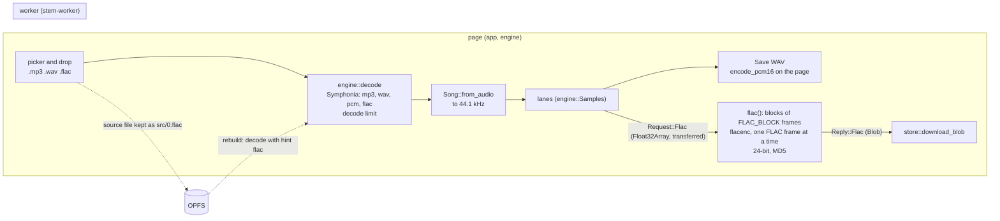

# FLAC input and output

## Purpose

Today the app opens WAV and MP3 files only, and saves a stem as a 16-bit WAV or a 192 kbps MP3.  After this plan, the app opens a FLAC file as a song or as a stem.  It also saves a stem as a 24-bit FLAC file.  FLAC is the usual lossless format for music downloads and for stems from other tools.  A FLAC stem is lossless and smaller than a WAV.

FLAC is specified in [RFC 9639](https://www.rfc-editor.org/rfc/rfc9639.html) (December 2024).  It holds 1 to 8 channels, rates from 1 Hz to 1,048,575 Hz, and 4 to 32 bits for each sample.

## Context and orientation

The state on 2026-10-25, at commit `945ffff` on `main`:

* `engine/src/decode.rs`: `decode_bytes` and `decode_path` decode with Symphonia 0.6.1.  `engine/Cargo.toml` enables the features `mp3`, `wav` and `pcm` only.  `most_frames` caps the reservation for each channel by what the file's bytes can hold.  `append` grows a channel by an eighth past its reservation.  No limit stops the decoded length.
* `engine/src/song.rs`: `Song::load_folder` takes `wav` and `mp3` only.  `Song::load_files` passes the extension to the probe as a hint.  `Song::from_audio` keeps the first two channels and converts to 44.1 kHz (decision 0012).
* `app/src/lib.rs`: `SONG_FILES` (`".mp3,.wav"`) is the picker's `accept`.  `WELCOME` and the hover text of "Open song…" name WAV and MP3.  The "Save" menu of each lane has "WAV (16-bit, lossless)", which `engine::wav::encode_pcm16` makes on the page, and "MP3 (192 kbps)", which the worker makes.
* `app/src/store.rs`: `save_sources` keeps each source file as `src/<i>.<ext>`, so a FLAC source is kept as `0.flac`.  `rebuild` decodes it with that extension as the hint.  Stems are kept as 16-bit WAV.  This plan does not change the stem format in storage.
* `protocol/src/lib.rs`: `Request::Mp3 { name, left, right, rate }` and `Reply::Mp3 { name, bytes }`.
* `worker/src/web.rs` `mp3`: reads the channels from JS in blocks of `MP3_BLOCK` frames, encodes with `rusty_mp3`, and sends the file back.  `worker/src/web/tests.rs` `an_mp3_is_encoded_in_blocks` bounds its peak memory.
* `xtask/src/serve.rs`: gives a MIME type for `wav` and `mp3`.
* `xtask/src/rules.rs`: `AUDIO_EXTENSIONS` already has `flac`, so ASSET-1 refuses a tracked FLAC file.  Tests make their FLAC files in memory.
* `THIRD-PARTY.md`: names Symphonia for MP3 and WAV, and `rusty_mp3`.

Terms:

* Frame (audio): one sample for each channel at one time.  Frame (FLAC): one coded block of audio frames, with a header and a CRC-16.  This plan writes "FLAC frame" for the second.
* Block size: the audio frames in one FLAC frame, 16 to 65,535 (RFC 9639 section 8.2).
* Constant subframe: a channel of a FLAC frame that stores one sample for the whole block (RFC 9639 section 9.2.3).
* STREAMINFO: the first metadata block of a FLAC file.  It gives the rate, the channels, the bits, the total frames and an MD5 of the audio.  A total of 0 and an MD5 of 0 mean "unknown".

## Design

### Input

Enable Symphonia's `flac` feature in `engine`.  It adds `symphonia-bundle-flac` 0.6.1 (MPL-2.0), from the same repository as the other Symphonia crates.  It reads the native FLAC container (`.flac`).  FLAC in Ogg, Matroska or MP4 is out of scope.

A FLAC file brings a risk that WAV and MP3 do not have: a small file can decode to a very large one.  A FLAC frame of 65,535 frames of silence in stereo takes about 20 bytes: a header of about 10 bytes, two constant subframes of 3 bytes and a CRC-16.  It decodes to 524,280 bytes of `f32`.  That is about 25,000 times its size, so a 1 MB file can state and hold about 25 GB of audio.  WebAssembly on wasm32 has 4 GiB at most, and iOS stops the tab at 2 GB (MEM-4).  Today `append` grows a channel with no limit, so such a file stops the tab.  A crafted file or a damaged one can do this.

So the decoder gets two guards:

* The reservation: `most_frames` gets a FLAC case.  The stated total of STREAMINFO is trusted up to a ratio of the file's bytes, which M1 measures on the demo song's stems.  Past it, the channel grows by an eighth, as now.
* The decode limit: `decode_into_reservation` stops with "the song is too long to open" when the decoded `f32` of all channels passes `MAX_DECODED_BYTES`.  The proposed value is 1 GiB: 50.7 minutes of 44.1 kHz stereo, or 23.3 minutes of 96 kHz stereo.  The limit is in `engine`, before `from_audio`, so it also guards a long WAV or MP3 (decision point 3).

High-resolution FLAC (24-bit, 88.2 to 192 kHz) is common.  Symphonia gives it as `f32`, and `to_rate` converts it to 44.1 kHz (decision 0012).  A FLAC with more than two channels keeps its first two, front left and front right (RFC 9639 section 9.1.3), as a WAV does today.  So a 5.1 mix loses its centre channel.  M1 records this gap in `docs/tech-debt.md`.

### Output

The worker encodes a FLAC, as it encodes an MP3.  An encode takes seconds for a song, so on the page it would stop the UI.  The encoder is `flacenc` 0.5.1 ([docs.rs](https://docs.rs/flacenc/0.5.1/flacenc/), Apache-2.0, pure Rust), with its default features off.  Its default feature `par` uses threads, which `wasm32-unknown-unknown` does not have.

The encode keeps no song-sized buffer in WebAssembly memory (MEM-1, MEM-4):

1. `flac` reads `FLAC_BLOCK` frames of each channel from JS at a time, as `mp3` does.  It quantises them to 24 bits, rounds and clips at full scale, as `encode_pcm16` does at 16 bits.
2. `flacenc::encode_fixed_size_frame` encodes each block as one FLAC frame.  The worker writes the frame to bytes, and puts the bytes in a JS array of parts.  `StreamInfo::update_frame_info` records the frame sizes and the total.  An `md-5` hasher takes the samples, as RFC 9639 gives them for the MD5.
3. At the end, the worker writes `fLaC` and the STREAMINFO block, with `StreamInfo::set_md5_digest`, as the first part.  It makes a `Blob` of the parts, and sends `Reply::Flac { name, file: Blob }`.  A `Blob` crosses `postMessage` as a reference, not as a copy of its bytes.
4. The page downloads the `Blob` through an object URL (`store::download_blob`).

The block size is 4,096 frames.  The streamable subset of RFC 9639 (section 7) allows at most 4,608 at 48 kHz or less, so every player can read the file.

The stem is written at 24 bits.  24 bits keep the model's output to about -144 dB, so the "lossless" label holds.  16 bits would make a smaller file, and the 16-bit WAV stays for that (decision point 2).

The wire changes: one new request and one new reply, both `{type: "flac", ...}`.  `stem-protocol` gets the one encoder and decoder of each (PROTO-1).  The hand-written e2e scripts change in the same commit if they post one.

### Dependencies (DEPS-1)

* `symphonia` keeps its version.  Its `flac` feature adds `symphonia-bundle-flac` 0.6.1.
* `flacenc = { version = "=0.5.1", default-features = false }` in `stem-worker` for `wasm32`.  It is also a dev-dependency of `engine` and a dependency of `xtask`, to make FLAC test files in memory.  Its first version came out on 2022-06-06 and 0.5.1 on 2025-12-18 ([lib.rs](https://lib.rs/crates/flacenc)).  It has one maintainer and modest use (about 8,000 downloads), and its API changes with each minor version.  So the plan pins it exactly, and does not add it to `SETTLED_CRATES`.
* `symphonia` with `flac` as a `wasm32` dev-dependency of `stem-worker`, to decode the worker's FLAC in its browser tests.  The tests then check a second implementation, not `flacenc` against itself.
* `THIRD-PARTY.md`: the new rows, and the notes on Symphonia and `flacenc`.

### Not taken

* An encoder written in this repo (fixed predictors and Rice codes, about 400 lines).  It adds no crate.  But it is new code for a bit format, and its files are larger than with linear prediction.  It stays the fallback if `flacenc` fails the spike in M4.
* `libflac-rs`, a port of libFLAC 1.4.3 that says it gives the same bytes as libFLAC ([docs.rs](https://docs.rs/crate/libflac-rs/latest)).  It is newer and less used than `flacenc`, and the app needs no byte-for-byte match.
* The encode on the page: it stops the UI for seconds.
* One `{type: "encode", format}` message for MP3 and FLAC: it changes the MP3 wire format for no gain.
* FLAC for stems in browser storage: it would halve the storage, but each reopen would decode on the page.  It is a follow-up, not this plan.

## Decision points

The maintainer chose on 2026-10-25 (see the decision log).  The chosen option is first.

1. The encoder: `flacenc` =0.5.1 (chosen), an encoder in this repo, or `libflac-rs`.
2. The bits of a saved FLAC: 24 (chosen) or 16.
3. The decode limit: 1 GiB of decoded `f32` for all formats (chosen), for FLAC only, or another value.  The choice for all formats changes what a long WAV or MP3 does, so decision 0013 records it.

## Plan of work

One PR, one signed commit for each milestone, then the fix commits of review rounds 1, 2 and 3.

### M0: this plan, and decision 0013

Acceptance: `cargo run -p xtask -- docs-check` passes with the plan and the decision in the index.

### M1: engine decodes FLAC

* `engine/Cargo.toml`: add the `flac` feature to `symphonia`.  Add `flacenc` as a dev-dependency.
* `engine/src/decode.rs`: the FLAC case of `most_frames`.  Measure the ratio on the stems of `synth`'s demo song, and on silence, and write the numbers in Surprises.
* `engine/src/song.rs`: `load_folder` takes `flac`.
* Tests in `cargo test -p engine`, each with a FLAC that `flacenc` makes in memory:
  * `a_16_bit_flac_decodes_exactly` and `a_24_bit_flac_decodes_exactly`: every sample within half a step of the input, and no spare capacity.
  * `a_96k_flac_opens_at_44k`: a 96 kHz FLAC opens with 44,100 frames for each second.
  * `a_flac_passes_its_md5`: decode with `verify: true`, and `finalize` gives `verify_ok == Some(true)`.
  * `a_truncated_flac_decodes_what_is_there`.
  * `a_flac_with_no_extension_is_probed`: `decode_bytes(bytes, None)` decodes it.
  * `a_folder_with_a_flac_stem_loads_it`.
* `docs/tech-debt.md`: a new entry for the 5.1 gap.  `THIRD-PARTY.md`: `symphonia-bundle-flac`.

Acceptance: the tests fail before the feature is enabled ("unsupported or unrecognised format") and pass after it.  All the checks of GIT-2 pass.

### M2: the decode limit

* `engine/src/decode.rs`: `MAX_DECODED_BYTES`, checked in `decode_into_reservation` before each `append`.
* Tests:
  * `a_flac_that_expands_past_the_limit_is_refused`: `flacenc` encodes silence in FLAC frames of 65,535 frames, for 2 hours of stereo.  The file is a few hundred kB.  The decode fails with "too long to open".  A counting allocator, as in `an_mp3_is_encoded_in_blocks`, shows that the peak stays under the limit plus one FLAC frame.
  * `a_header_that_states_hours_reserves_at_most_the_ratio`: a FLAC whose STREAMINFO states 10 hours reserves no more than the FLAC case of `most_frames` allows.
  * `a_song_under_the_limit_opens`: a 10-minute 44.1 kHz stereo WAV opens.
  * If decision point 3 takes all formats: `a_wav_past_the_limit_is_refused`, with a streaming WAV header so the test does not hold 1 GiB.

Acceptance: before the change, the first test passes the limit (the counting allocator records more than 1 GiB, or the test stops with an allocation failure).  After the change, every test passes.

### M3: the page opens FLAC

* `app/src/lib.rs`: `SONG_FILES` becomes `".mp3,.wav,.flac"`.  `WELCOME` and the hover text name FLAC.
* `xtask/src/serve.rs`: `flac` gives `audio/flac`.
* `app/tests/web.rs`: `a_flac_session_reopens_with_its_stems`.  Keep a FLAC source, keep stems, open the session again.  Every lane has the same frame count as on the first open.
* If the welcome text is in a UI snapshot: run `UPDATE_SNAPSHOTS=1 cargo test -p app --test ui`, and commit only the changed PNG.
* DOC-1: `README.md` (the formats that open), the `engine` line and the flowchart in `docs/ARCHITECTURE.md`.

Acceptance: `cargo run -p xtask -- web-test` passes with the new test, and the test fails before M1.

### M4: the worker encodes FLAC

* Spike first, on `wasm32`: confirm that `flacenc` with no default features builds for `wasm32-unknown-unknown`.  Confirm that `encode_fixed_size_frame` and `update_frame_info` give a file that Symphonia decodes, with a correct MD5.  Write the result and the encode time of 5 minutes of stereo in Surprises.  If the spike fails, stop and ask the maintainer (decision point 1).
* `protocol/src/lib.rs`: `kind::FLAC`, `Request::Flac { name, left, right, rate }` (buffers transferred) and `Reply::Flac { name, file: Blob }`.  Tests in `protocol/tests/web.rs`: `a_flac_request_keeps_its_name_and_rate` and `a_flac_reply_keeps_its_blob`.
* `worker/src/web.rs`: `flac`, as in the design.
* `worker/src/web/tests.rs`:
  * `a_flac_decodes_to_the_stem`: Symphonia decodes the reply's `Blob`.  Every sample is within half a 24-bit step, the rate is the request's rate, and `verify_ok == Some(true)`.
  * `a_flac_is_encoded_in_blocks`: the counting allocator bounds the peak WebAssembly memory to a few blocks, not the stem.
  * `a_flac_of_unequal_channels_stops_at_the_shorter`, as for MP3.
  * `a_flac_clips_at_full_scale`: +1.5 decodes to the largest 24-bit step.
* The e2e scripts in `xtask/src/e2e.rs`, if they post an MP3 request (PROTO-1).  `cargo test -p xtask --test rules` passes.

Acceptance: `cargo run -p xtask -- web-test` passes with the new tests.  `a_flac_is_encoded_in_blocks` fails against a version of `flac` that encodes the whole stem in one call.

### M5: the page saves FLAC

* `app/src/separator.rs`: `encode_flac` and `Event::Flac { name, file }`.  Test `a_flac_reply_reaches_the_page_as_sent`: the page gets the same `Blob` (MEM-2).
* `app/src/store.rs`: `download_blob`, with an object URL that the page revokes after the click.
* `app/src/lib.rs`: "FLAC (24-bit, lossless)" in the "Save" menu, between WAV and MP3.  The error label "FLAC encoding".
* DOC-1: `README.md` (saving a stem), and the message list at the top of `protocol/src/lib.rs`.

Acceptance: the separator test passes in `web-test`.  The UI snapshots pass, or change only in the "Save" menu.

### M6: end to end, and on real hardware

* `xtask/src/e2e.rs` `clip`: an option to write the clip as a 24-bit 96 kHz FLAC with `flacenc`.  `cargo run -p xtask -- e2e separate` passes on that clip with 6 stems.
* A person, on an iPhone: "Open song…" offers a `.flac` file in Files, and a FLAC stem saves.  Write the device and the iOS version in Progress.

### Review

Run `cargo build -p xtask`, then `/review-rounds` for rounds 1, 2 and 3 over the PR's commits.

## Validation and acceptance

* `cargo fmt --all --check`, each clippy command in `CLAUDE.md`, `cargo test --workspace --exclude roformer-gpu`, `cargo test -p roformer-gpu --lib` and `cargo run -p xtask -- docs-check` pass.
* `cargo test -p xtask --test rules` passes, with `third_party_lists_what_ships` and `young_crates_are_pinned`.
* `cargo run -p xtask -- web-test` passes, in Chrome and in Safari.
* `cargo run -p xtask -- e2e separate` passes on the FLAC clip.

## Idempotence and recovery

* Each milestone is one signed commit.  To undo one, revert it.
* To resume, read Progress, then `git log --oneline 945ffff..HEAD`.
* Browser storage keeps a FLAC source as it is.  A revert of M1 makes that session fail to open with "unsupported or unrecognised format", and the user can forget it.  No stored stem changes format.

## Progress

* [x] 2026-10-25: decision points 1, 2 and 3 chosen by the maintainer (decision 0013).
* [x] 2026-10-25: M0: plan and decision 0013.  fmt, the xtask tests and `docs-check` pass.
* [ ] M1: engine decodes FLAC.
* [ ] M2: the decode limit.
* [ ] M3: the page opens FLAC.
* [ ] M4: the worker encodes FLAC.
* [ ] M5: the page saves FLAC.
* [ ] M6: end to end, and on real hardware.
* [ ] Review rounds 1, 2 and 3.

## Surprises and discoveries

* 2026-10-25: Symphonia 0.6.1 has a `flac` feature, in its default features, which `engine` turns off with `default-features = false`.  So input needs no new top-level crate.
* 2026-10-25: `xtask/src/rules.rs` already lists `flac` in `AUDIO_EXTENSIONS`, so ASSET-1 already covers FLAC files.

## Decision log

* 2026-10-25, maintainer: the encoder is `flacenc` =0.5.1, with the encoder in this repo as the fallback.
* 2026-10-25, maintainer: a saved FLAC has 24 bits for each sample.
* 2026-10-25, maintainer: the decode limit is 1 GiB of decoded `f32`, for every format (decision 0013).

* 2026-10-25, agent: the encode runs in the worker, as the MP3 encode does, so the page stays responsive.
* 2026-10-25, agent: the worker sends a `Blob` of FLAC frames, not one `Uint8Array`, so WebAssembly memory never holds the whole file (MEM-1, MEM-4).

## Outcomes and retrospective

Not started.
