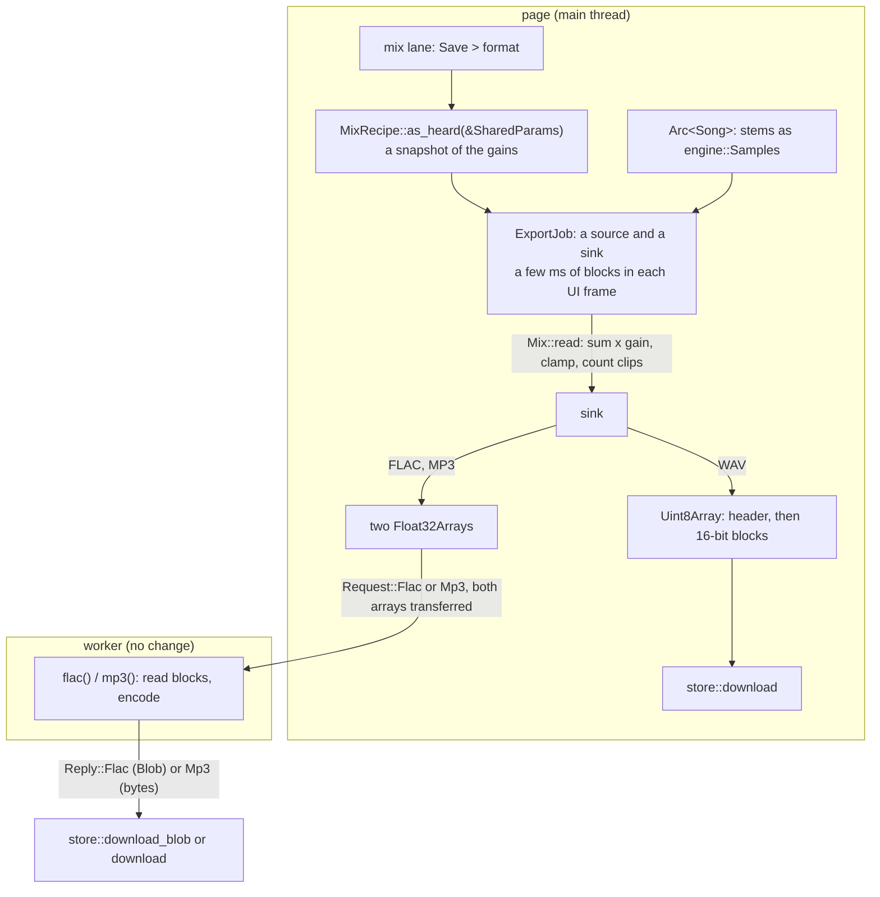

# Save the mix as you hear it

## Purpose

Today each stem saves on its own.  A user who wants a backing track (all stems except the vocals) must save five files and sum them in another tool.  After this plan, the mix lane has a "Save" menu, as every stem lane has.  It saves one file of the mix that the user hears: the stems that Mute and Solo let through, at their volumes.  The formats are the same as for a stem: WAV, FLAC and MP3.  The stem saves stay.

The maintainer chose this design (option C of six) on 2026-10-25.  Decision 0014 records it.

## Context and orientation

The state on 2026-10-25, at commit `db64d15` on `main`:

* `app/src/lib.rs`:
  * `lane_controls` draws each lane's name and, on the web, a "Save" menu for each stem lane.  The mix lane has no menu.  Its subtitle is "sum of all stems".
  * WAV: `engine::wav::encode_pcm16` makes the whole file in WebAssembly memory, then `store::download` copies it to a `Uint8Array`.
  * FLAC and MP3: `Separator::encode_flac` and `encode_mp3` copy each channel to a `Float32Array` and post it to the worker.
  * `load_song` builds the lanes.  The mix lane's peaks come from `mix_of_sources`: every stem but the `DERIVED` lanes ("classic drums", "original"), at full volume.
* `engine/src/params.rs`: `SharedParams::effective_gain` gives the gain the player applies to a stem: 0 when muted or when another stem is soloed, else its volume.
* `engine/src/player.rs`: the player sums the stems with their gains, stretches the sum, applies the master volume and clamps to ±1.
* `dsp/src/mix.rs`: `dsp::mix` sums whole stems into a new buffer of the song's length, and clamps to ±1.
* `worker/src/web.rs`: `mp3` and `flac` read the two channels from JS in blocks, encode them and send the file back.  `protocol/src/lib.rs`: `Request::Mp3` and `Request::Flac` take any two channels.
* On the web, cpal 0.18.2 fills the audio buffers in the `ended` handlers of Web Audio buffer sources.  These run on the page's main thread (`cpal` `src/host/webaudio/mod.rs`).  So long work on the main thread can stop the audio as well as the UI.

Terms:

* As heard: each stem at `effective_gain`, summed, at 100% tempo.  The master volume is 1 in the app, and the UI does not show it.
* Recipe: the gain of each stem in a mix, fixed when the user clicks Save.
* Block: a run of frames that the page mixes at one time.

## Design

The page mixes the song, block by block, over several frames of the UI.  It writes each block into JS arrays, outside WebAssembly memory.  The worker encodes FLAC and MP3 as it does today.  The page makes the WAV.

Why the page and not the worker:

* The stems live on the page as `engine::Samples`.  The worker sends each chunk's stems to the page and does not keep them.  A song that the page restores from browser storage never reaches the worker.
* To mix in the worker, the page must copy every stem to JS.  For a 146.7 s song, that is 6 x 51.8 MB, against 51.8 MB for the mix.
* The worker would need `dsp` or `engine`.  `app` and `stem-worker` may share only `stem-protocol` (LAYER-1).

The pieces, from the bottom layer up:

1. `dsp::mix_range(stems, volumes, start, length) -> Vec<f32>`, in DSP-1 style.  It sums `length` frames from `start`, and clamps to ±1.  It returns a new block, since DSP-1 has no `&mut [f32]`.
2. `engine::mixdown` (new):
   * `MixRecipe`: an immutable `Vec<f32>` of gains, one for each stem.  `MixRecipe::as_heard(&SharedParams)` takes each `effective_gain`.  `audible()` gives the stems with a gain above 0.
   * `trait Pcm { frames, sample_rate, read(at, left, right) -> usize }`.  `read` fills one block and returns the samples at full scale (±1 or beyond).
   * `Mix { song: Arc<Song>, recipe }` implements `Pcm` with `dsp::mix_range`.  `StemPcm { stem: Stem, rate }` implements it with a copy of the block.  It never clamps.
3. `engine::wav`: `header(frames, rate) -> [u8; 44]` and `write_pcm16(left, right, out)`.  `encode_pcm16` uses them, and gives the same bytes as before.
4. `app/src/export.rs` (new):
   * `trait Sink { fn write(&mut self, at: usize, left: &[f32], right: &[f32]) }`.
   * `ExportJob { source: Box<dyn Pcm>, sink, at, clipped, name, format }`.  `step(max_frames)` reads one block into two reusable buffers and writes it to the sink.  It returns `true` at the end.
   * Names and labels: `mix_label(song, recipe)` for the mix lane's subtitle, and `mix_file_name(base, song, recipe)`.
   * On the web: `JsChannels` (two `Float32Array`s of the song's length) and `JsWav` (one `Uint8Array` of 44 + 4 bytes for each frame).  Each writes a block with `subarray(..).copy_from(..)`.
5. `app/src/lib.rs`:
   * The mix lane gets the same "Save" menu as a stem lane.  A top line says "Saves what you hear: <stems>, at their volumes, at 100% tempo."
   * Every Save starts an `ExportJob`, a stem's too.  So no save makes a song-sized buffer in WebAssembly memory.
   * Each UI frame steps the job for about 4 ms, by `Performance::now`, and asks for a repaint.  The status line shows "Mixing <name>: 42 %".
   * At the end: a WAV downloads.  The page posts a FLAC or MP3 request with the two arrays, as it does today.
   * One job at a time; the menu is disabled while a job runs.  The mix lane's menu is disabled when nothing is audible ("Unmute a stem to save a mix").
   * `load_song` drops the job, so an old song does not stay in memory.
   * When samples clip, the status says how many, and suggests lower volumes.
6. `app/src/separator.rs`: `encode_mp3` and `encode_flac` take the two `Float32Array`s.  The protocol and the worker do not change (PROTO-1).
7. The mix lane's subtitle says what it plays: "as heard: all stems", "as heard: all stems except vocals", "as heard: bass, drums" or "as heard: nothing".  Its waveform follows the mix.  A change of the recipe starts a peaks job.  This is the same `ExportJob` with a sink that keeps the minimum and maximum of each column.

Names: `<song> - mix.<ext>` when every source stem is audible, at any volume, and no derived lane is.  Else `<song> - mix without vocals.<ext>`, or `<song> - mix of bass, drums.<ext>`, whichever lists fewer stems.  A derived lane that is audible makes the list form.

Natively, the app has no Save menu.  A native frame steps a job to its end, so the UI tests see the final waveform in one run.

### Memory (MEM-1, MEM-2, MEM-4)

* WebAssembly: two blocks of 16,384 frames for each channel, 256 KB in all.  No buffer of the song's length.
* JS: the two `Float32Array`s of the mix, 51.8 MB for a 146.7 s song.  A stem save makes the same arrays today.  They are transferred to the worker.
* The job holds an `Arc<Song>`, not a copy.

### Not taken

* Mixing in the worker: see the design.
* The mix at the chosen tempo: a later change can render it with `Player::render` and its own `SharedParams`.  The menu says "at 100% tempo".
* Normalising the mix: the file clamps as playback clamps.  The status reports the clipped samples.
* Saving only the loop region.

## Decision points

None open.  The maintainer chose option C and the page-side mix on 2026-10-25 (decision 0014).

## Plan of work

One PR.  One signed commit for each milestone, then the fix commits of review rounds 1, 2 and 3.

### M0: this plan, and decision 0014

Acceptance: `cargo run -p xtask -- docs-check` passes with the plan and the decision in the index.

### M1: the mix in blocks (dsp, engine)

* `dsp/src/mix_range.rs`: `mix_range`.  `dsp::mix` stays as it is.
* `engine/src/mixdown.rs`: `MixRecipe`, `Pcm`, `Mix`, `StemPcm`.
* `engine/src/wav.rs`: `header` and `write_pcm16`; `encode_pcm16` on top of them.
* Tests in `cargo test -p dsp` and `cargo test -p engine`:
  * `mix_range_matches_mix_at_any_start`: every start and length gives the slice of `dsp::mix`.
  * `clamps_to_one`, `no_stems_is_silence` and `a_short_stem_panics`.
  * `a_mix_read_in_blocks_equals_dsp_mix`: block sizes 1, 7 and 16,384, and a last short block.
  * `a_mix_counts_samples_at_full_scale`.
  * `as_heard_follows_mute_solo_and_volume`.
  * `a_stem_pcm_is_the_stem_unclamped`.
  * `encode_pcm16_is_header_then_blocks`: the same bytes as a block-by-block write.
  * `encode_pcm16_writes_the_bytes_it_wrote_before`: against a copy of the old writer.

Acceptance: the tests pass.  `a_mix_read_in_blocks_equals_dsp_mix` fails if `Mix::read` ignores `at`.

### M2: the export job, names and the mix lane (app, native)

* `app/src/export.rs`: `Sink`, `ExportJob`, `Format`, `mix_label`, `mix_file_name`, and the peaks sink.
* `app/src/lib.rs`: the subtitle and the waveform of the mix lane follow the recipe.
* Tests in `cargo test -p app`:
  * `a_job_in_steps_writes_the_whole_mix_once`: a test sink records each `at`.  The frames are contiguous and cover the song.
  * `a_job_counts_clipped_samples`.
  * `mix_labels_and_names`: all, all but one, a few, nothing, and a derived lane.
  * `the_demo_mix_without_lead_is_the_sum_of_the_other_stems`: the `synth` song, against `dsp::mix` of its other stems.  It is in `app`, since `engine` may not take `synth` (LAYER-1).
  * `the_mix_lane_follows_mute` in `app/tests/ui.rs`: mute "lead", and the mix lane's columns equal the peaks of the other stems.
  * Snapshots: `muted_drums.png` changes (subtitle and waveform).  Update it with `UPDATE_SNAPSHOTS=1 cargo test -p app --test ui`, and look at it.

Acceptance: the tests pass.  `the_mix_lane_follows_mute` fails before the change.

### M3: the web saves (app, wasm)

* `app/src/export.rs`: `JsChannels` and `JsWav`.
* `app/src/lib.rs`: the mix lane's Save menu, the job in each frame, the status, the cancel in `load_song`.  Each stem's Save uses the job too.
* `app/src/separator.rs`: `encode_mp3` and `encode_flac` take `Float32Array`s.
* Browser tests (`cargo run -p xtask -- web-test`):
  * `js_channels_hold_the_mix`: the arrays equal `dsp::mix` of the audible stems.
  * `js_wav_is_the_wav_of_the_mix`: the bytes equal `encode_pcm16` of the same mix.
  * `a_mix_export_does_not_grow_wasm_memory`: a 60 s song, then a whole job.  The page's WebAssembly memory grows by less than 1 MB.  It grows by about 21 MB if the job keeps the mix in WebAssembly.
  * `encode_mp3_asks_the_worker_for_an_mp3`, as for FLAC (TD-53 names its absence).
* TD-53: add the mix lane's Save menu to the untested items.  A native test cannot reach the wasm-only menu.

Acceptance: `web-test` passes in Safari or Chrome.  `a_mix_export_does_not_grow_wasm_memory` fails with a sink that collects into a `Vec`.

### M4: docs and the real page

* DOC-1: `README.md` (saving a stem or a mix), `docs/ARCHITECTURE.md` (the crates list, and a short "Saving" section with the flowchart).
* `trunk build --release` and `xtask serve`.  Save a mix with vocals muted, in each format.  Confirm that playback does not stop while it mixes.  Record the time of one step.

Acceptance: `docs-check` passes.  The manual check is in Progress, with the browser and the step time.

### Review

Run `cargo build -p xtask`, then `/review-rounds main 1 "docs/plans/active/mix-download.md#Design"`, then rounds 2 and 3.

## Validation and acceptance

* `cargo fmt --all --check`, each clippy command in `CLAUDE.md`, `cargo test --workspace --exclude roformer-gpu`, `cargo test -p roformer-gpu --lib` and `cargo run -p xtask -- docs-check` pass.
* `cargo run -p xtask -- web-test` passes.
* On the built page, a mix with vocals muted saves as WAV, FLAC and MP3.  Each file plays the other stems only.

## Idempotence and recovery

* Each milestone is one signed commit.  To undo one, revert it.
* To resume, read Progress, then `git log --oneline db64d15..HEAD`.
* Nothing is stored.  The wire format does not change.

## Progress

* [x] 2026-10-25: the maintainer chose option C and the page-side mix (decision 0014).
* [x] 2026-10-25: M0: plan and decision 0014 (`231255b`).  `docs-check` and the xtask tests pass.
* [x] 2026-10-25: M1: the mix in blocks.  `cargo test -p dsp` (35) and `cargo test -p engine --lib` (99) pass, with `dsp_is_beginner_style`.
* [x] 2026-10-25: M2: the export job, names and the mix lane.  `cargo test --workspace --exclude roformer-gpu` passes (588).  `the_mix_lane_follows_mute` fails with `follow_mix` turned off.  Four snapshots changed: the subtitle in each, and the mix waveform in `muted_drums`.
* [x] 2026-10-25: M3: the web saves.  `web-test` passes in Safari, with 3 new tests in `export` and 2 in `separator`.  With a sink that collects into a `Vec`, `a_mix_export_does_not_grow_wasm_memory` fails: 34.1 MB of growth.  TD-53 now names `save_menu`, `start_save` and `step_save`.
* [ ] M4: docs and the real page.
* [ ] Review rounds 1, 2 and 3.

## Surprises and discoveries

* 2026-10-25, M1: DSP-1 allows no `&mut [f32]`.  So `dsp::mix_range` returns a new block, and the engine copies it into the caller's buffer.  So `Pcm::read` counts the samples at full scale, not the clamped ones.  A sample of exactly ±1 counts too.
* 2026-10-25, M1: LAYER-1 forbids `synth` as a dev-dependency of `engine`.  The test of the demo song moves to M2, in `app`.

## Decision log

* 2026-10-25, maintainer: option C.  The mix lane gets a Save menu that saves the mix as heard (decision 0014).
* 2026-10-25, maintainer: the page mixes in blocks into JS arrays, and the worker encodes as it does today.
* 2026-10-25, agent: every Save uses the export job, a stem's too.  So the WAV save no longer makes the whole file in WebAssembly memory.
* 2026-10-25, agent: the mix saves at 100% tempo, clamped as playback clamps.
* 2026-10-25, agent, M2: the mix lane's spectrogram follows the mix too.  It is made again, in one frame, when its mix changes, as every spectrogram is made today.
* 2026-10-25, agent, M3: the FLAC and MP3 items are disabled when the page has no worker.  Before, a click did nothing.
* 2026-10-25, agent, M3: `load_song` drops a save in progress, also when separated stems arrive.  The status line then shows the separation.
* 2026-10-25, agent, M3: the status names the clipped samples of a mix only.  A stem saves as it is, as before.
* 2026-10-25, agent, M2: the waveform job runs for 3 ms of each frame on the web.  Natively, it runs to its end in one frame, since native audio has its own thread.

## Outcomes and retrospective

Not done yet.
